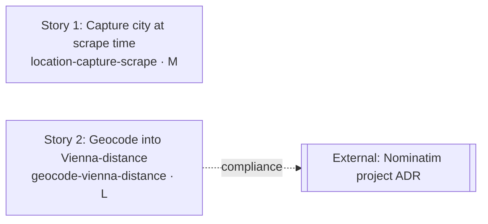

# Plan: Precise Job Location for Distance-Based Ranking

## Roadmap Overview

We make the digest's `location` field specific (city, or region when no city is available) so the
Vienna-distance ranking becomes discriminating instead of flat-per-country, and so the reader can
visually judge relevance. The work splits cleanly along two **disjoint files** — the scrape side
(`scrape_jobs.py`) captures/recovers a specific location string, and the rank side (`rank_jobs.py`)
turns any location string into a real distance via OpenStreetMap Nominatim geocoding with the
existing coordinate table as a fast-path cache.

Two stories, touching no common file, so they are **fully parallel**. Total complexity ≈ one M + one
L. No new Python library or secret is introduced (Nominatim is called with the existing `requests`
dependency), so there is no workflow/`pip install` change and nothing to deploy beyond the merged
code. The digest renderer needs no change: `create_issue.py:118` already prints `job.get("location")`
verbatim, so a richer location string surfaces automatically.

One governance item is **not code**: the CIG check returned `NO_COVERAGE` for Nominatim, requiring a
project ADR. It is tracked in External Action Items.

## Dependency Graph

No arrows between S1 and S2 — they share no files and can be implemented, reviewed, and merged in
either order or simultaneously. Critical path = Story 2 (the larger of two independent stories).

## Stories

### Story 1: Capture a specific city at scrape time

- **Slug:** `location-capture-scrape`
- **Description:** In `scrape_jobs.py`, capture a specific city for postings instead of a bare
  country. (a) Fix `parse_karriere_at` to read the listing card's location element — the same lookup
  `parse_stepstone` and `parse_jobs_ch` already perform — and use it for `location`, falling back to
  `"Austria"` only when no element is present. (b) Add a bounded, cached job-page location-enrichment
  helper `_fetch_job_page_location(url)` mirroring the existing `_fetch_job_page_language`: per-URL
  cache `_PAGE_LOCATION_CACHE`, per-run cap via a new `SCRAPER_PAGE_LOCATION_ENRICH_MAX` env var,
  routes through the existing per-domain rate limiter, returns `None` on any failure (never raises).
  (c) In `scrape_jobs.main()`, for rows whose `location` is country-only or empty, call the helper
  once (within the per-run budget) to recover a city/region before `jobs_raw.json` is written. No
  change to `create_issue.py` — it already renders `job.get("location")` verbatim, so a richer string
  appears automatically.
- **Business Acceptance Criteria covered:** BAC-1, BAC-3 (and the fetch-side of BAC-5)
- **Complexity:** M
- **Dependencies:** None (parallel with Story 2 — touches different files)
- **Independently deployable:** Yes — a more specific `location` string improves known-city scoring
  immediately and degrades to today's behaviour for anything unrecognised.
- **Test mechanism note:** network is stubbed with `monkeypatch.setattr(scrape_jobs, …)` — the suite's
  established pattern (e.g. `_detect_lang_via_library`); no live HTTP.
- **Test names:**
  - `test_parse_karriere_at_uses_card_city_when_present` (CT / Functional) → BAC-1
  - `test_parse_karriere_at_falls_back_to_austria_when_no_city` (CT / Functional) → BAC-1
  - `test_location_enrichment_recovers_city_for_country_only_row` (CT / Functional) → BAC-3
  - `test_location_enrichment_respects_per_run_budget` (CT / Functional) → BAC-3
  - `test_location_enrichment_returns_none_on_fetch_failure` (CT / Functional) → BAC-5

### Story 2: Geocode arbitrary locations into the Vienna-distance score

- **Slug:** `geocode-vienna-distance`
- **Description:** In `rank_jobs.py`, resolve arbitrary city/region strings to coordinates via
  OpenStreetMap Nominatim and feed them into the existing `_haversine_km` distance-from-Vienna
  calculation. Keep `_DACH_LOCATION_POINTS` as a first-checked fast-path cache; only on a miss call a
  new `_geocode(location)` helper that queries Nominatim with `countrycodes=at,de,ch,it` (the
  project's established geographic scope — DACH plus South Tyrol/Italy, matching the existing
  `_COUNTRY_DISTANCE_FALLBACK` and the `Bolzano`/`Bozen` table entries), an explicit descriptive
  `User-Agent` header, and a connect/read timeout. `_geocode` caches every result including misses in
  a module-level dict, routes through the existing per-domain rate limiter, and returns `None` on
  timeout, non-2xx, or no-match. `_distance_from_vienna_km` uses geocoded coordinates when the table
  misses, accepts a region/state match as an intermediate, and falls back to
  `_COUNTRY_DISTANCE_FALLBACK` only when geocoding yields nothing. A new `RANK_GEOCODE_MAX` env var
  bounds geocoding calls per run; an env flag disables geocoding entirely, preserving today's exact
  behaviour. No new Python library (uses existing `requests`); no secret or API key. Reference:
  [Nominatim Search API](https://nominatim.org/release-docs/latest/api/Search/) and its
  [usage policy](https://operations.osmfoundation.org/policies/nominatim/).
- **Business Acceptance Criteria covered:** BAC-2, BAC-4, BAC-5, BAC-6, BAC-7
- **Complexity:** L
- **Dependencies:** None (parallel with Story 1 — touches different files)
- **Independently deployable:** Yes — gated by the disable flag; off = today's behaviour exactly.
- **Test mechanism note:** geocoding is stubbed with `monkeypatch.setattr(rank_jobs, …)` — the suite's
  established pattern; never hits live Nominatim.
- **Test names:**
  - `test_known_city_still_scores_from_table_without_geocoding` (CT / Functional) → BAC-6
  - `test_arbitrary_city_geocoded_to_distance_bucket` (CT / Functional) → BAC-2
  - `test_two_cities_same_country_score_by_distance` (CT / Functional) → BAC-2
  - `test_region_only_uses_region_coords_over_country_fallback` (CT / Functional) → BAC-4
  - `test_geocode_failure_falls_back_to_country_distance` (CT / Functional) → BAC-5
  - `test_geocode_result_cached_second_call_not_refetched` (CT / Functional) → BAC-7
  - `test_geocode_respects_per_run_budget` (CT / Functional) → BAC-2
  - `test_geocoding_disabled_preserves_current_scores` (CT / Functional) → BAC-6

## Test Plan

| Story | Test Name | Business Acceptance Criterion | ITPF Level / Type | What it verifies | Risk mitigated |
|-------|-----------|-------------------------------|-------------------|------------------|----------------|
| 1 | `test_parse_karriere_at_uses_card_city_when_present` | BAC-1 | CT / Functional | A Karriere.at card exposing a city yields that city in `location`, not `"Austria"` | Reader cannot judge relevance; ranking stays flat across all AT jobs |
| 1 | `test_parse_karriere_at_falls_back_to_austria_when_no_city` | BAC-1 | CT / Functional | When the card has no location element, `location` is `"Austria"` (no crash, no empty) | A parser change silently drops location entirely, breaking every AT row |
| 1 | `test_location_enrichment_recovers_city_for_country_only_row` | BAC-3 | CT / Functional | A country-only row triggers one page fetch (mocked) that sets a city/region | Jobs stay country-generic forever; precision work delivers nothing |
| 1 | `test_location_enrichment_respects_per_run_budget` | BAC-3 | CT / Functional | Beyond `SCRAPER_PAGE_LOCATION_ENRICH_MAX`, no further fetch is attempted | Unbounded fetching blows up runtime and trips rate limits / 429s |
| 1 | `test_location_enrichment_returns_none_on_fetch_failure` | BAC-5 | CT / Functional | A failed page fetch returns `None` and the row keeps its country location (no raise) | One bad page aborts the whole scrape, producing no digest |
| 2 | `test_known_city_still_scores_from_table_without_geocoding` | BAC-6 | CT / Functional | A city in `_DACH_LOCATION_POINTS` scores from the table and `_geocode` is never called | Known-city scores drift; a working ranking regresses |
| 2 | `test_arbitrary_city_geocoded_to_distance_bucket` | BAC-2 | CT / Functional | A non-table city (mocked geocode) maps to the correct distance bucket | Off-list cities stay at the coarse country score; ranking can't discriminate |
| 2 | `test_two_cities_same_country_score_by_distance` | BAC-2 | CT / Functional | Two same-country cities at different distances get different location scores | Near and far roles rank equally; the reader's top picks are wrong |
| 2 | `test_region_only_uses_region_coords_over_country_fallback` | BAC-4 | CT / Functional | A region/state string scores from region coords, not the country fallback | Region-only rows are needlessly demoted to the coarse country estimate |
| 2 | `test_geocode_failure_falls_back_to_country_distance` | BAC-5 | CT / Functional | When `_geocode` returns `None`, the score equals today's country fallback | A geocoding outage breaks scoring and no digest is produced |
| 2 | `test_geocode_result_cached_second_call_not_refetched` | BAC-7 | CT / Functional | A repeated location is served from cache; `_geocode` runs once | Duplicate lookups waste the Nominatim budget and make runs non-reproducible |
| 2 | `test_geocode_respects_per_run_budget` | BAC-2 | CT / Functional | Beyond `RANK_GEOCODE_MAX`, scoring falls back without more geocode calls | Unbounded geocoding breaches OSM usage policy and risks a ban |
| 2 | `test_geocoding_disabled_preserves_current_scores` | BAC-6 | CT / Functional | With geocoding disabled, every score equals today's output exactly | No safe rollback path; a bad geocoding rollout can't be turned off |

## BAC Coverage Matrix

| BAC | Stories | Tests | Covered? |
|-----|---------|-------|----------|
| BAC-1 — City shown instead of bare country | Story 1 | `test_parse_karriere_at_uses_card_city_when_present`, `test_parse_karriere_at_falls_back_to_austria_when_no_city` | ✓ |
| BAC-2 — Proximity reflected for arbitrary cities | Story 2 | `test_arbitrary_city_geocoded_to_distance_bucket`, `test_two_cities_same_country_score_by_distance`, `test_geocode_respects_per_run_budget` | ✓ |
| BAC-3 — Missing city recovered within budget | Story 1 | `test_location_enrichment_recovers_city_for_country_only_row`, `test_location_enrichment_respects_per_run_budget` | ✓ |
| BAC-4 — Region accepted when no city | Story 2 | `test_region_only_uses_region_coords_over_country_fallback` | ✓ |
| BAC-5 — Graceful degradation, run completes | Story 1, Story 2 | `test_location_enrichment_returns_none_on_fetch_failure`, `test_geocode_failure_falls_back_to_country_distance` | ✓ |
| BAC-6 — No regression for already-precise postings | Story 2 | `test_known_city_still_scores_from_table_without_geocoding`, `test_geocoding_disabled_preserves_current_scores` | ✓ |
| BAC-7 — Reproducible from cache | Story 2 | `test_geocode_result_cached_second_call_not_refetched` | ✓ |

No orphan BACs; every test references a BAC.

## Sequencing Strategy

Both stories are independently deployable and touch **disjoint files** (`scrape_jobs.py` +
`test_scrape_jobs.py` vs `rank_jobs.py` + `test_rank_jobs.py`), so they can be built and merged in
parallel with no ordering constraint and no merge-conflict risk. Story 2 is gated behind a disable
flag defaulting to today's behaviour, so it can merge "dark" and be enabled once validated. The
critical path is simply Story 2 (the larger story). There is no feature-flag coupling between the two
— shipping Story 1 alone already improves known-city precision; shipping Story 2 alone already
geocodes whatever location strings exist today.

## External Action Items

| Action | Repository | What to change | Owner/Team | Blocks Story |
|--------|-----------|----------------|------------|--------------|
| Author a project ADR for using public OpenStreetMap Nominatim geocoding (CIG `NO_COVERAGE`): rationale for public vs self-hosted endpoint, data classification (city/region strings only — no PII), resilience config (timeouts + graceful degradation), and caching/rate-limit strategy. Reference CIG ADRs #20, #1, #412/#414. | this repo (`docs/adrs/`) | repo team | Compliance gate for Story 2 (does not block code implementation, required before/with merge) |
