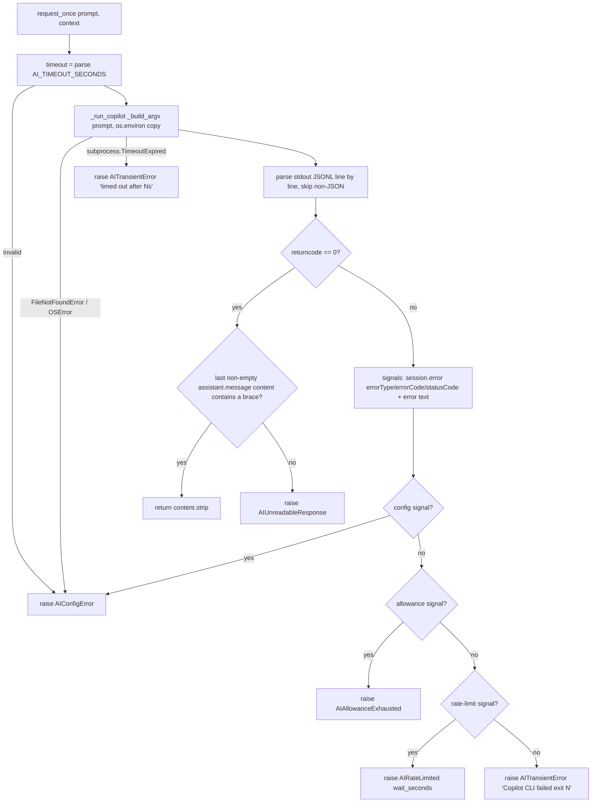

# Specification: Shared Copilot client: switch, transport, error classification

## Context

GitHub retired GitHub Models on 2026-07-30. Since then every AI stage fails silently: `github_models.complete_json`
logs the error and returns `None`, and the workflow hides the failure with `continue-on-error`
([PRD ai-enrichment-reliability](../../prds/ai-enrichment-reliability/prd.md)). The PRD moves all three AI stages
onto **GitHub Copilot CLI in programmatic mode** (`copilot -p`), behind **one shared fail-loud client** and an
**operator switch that is off by default** ([plan](../../prds/ai-enrichment-reliability/plan.md)).

This story builds the **lower half** of that client. It adds the new module `.github/scripts/copilot_client.py`
with four parts:

1. **The switch:** `ai_enabled()`, which every stage and the digest consult.
2. **The transport:** one no-tools `copilot -p` invocation through a monkeypatchable subprocess wrapper.
3. **The classifier:** `request_once()` turns one CLI attempt into either the answer text or one of five typed
   errors. The errors name the stage and are scrubbed of credential values.
4. **The retry policy:** not in this story. `complete_json`, retries and `AIUnavailable` come in S3.

Nothing imports the module until S4, so this PR is inert at runtime.

The classification is grounded in two sources of evidence:

- **Recorded S1 probe output.** These are the real outputs of CLI 1.0.109 from run 43237422651; see
  [findings.md](../copilot-cli-probe/findings.md). They cover invalid model, no token and an unpermitted token.
- **The CLI 1.0.109 embedded session-event schema and message strings.** I extracted these from the pinned
  `@github/copilot-linux-x64@1.0.109` binary while specifying this story. They cover rate limits and
  allowance/quota, which S1 could not provoke.

The fixtures derived from the schema are labelled as such. See the
[deviation note](#deviation-from-the-plan-fixture-provenance).

## Dependencies

- **Blocked by:** `copilot-cli-probe` (S1, done as findings only). It supplies:
  - the CLI version (1.0.109) and the output mode (`--output-format json -s`);
  - the model (`gpt-6-luna`) and the flag set (`--disable-builtin-mcps`, `--no-custom-instructions`);
  - the rule "every failure exits 1, classify by message";
  - the recorded P4/P5/P7 failure outputs and the success JSONL shapes.
- **Blocks:**
  - `copilot-client-retry-policy` (S3, same file). It needs:
    - the error classes, with the rule that `AIConfigError` and `AIAllowanceExhausted` are never retried;
    - `AIRateLimited.wait_seconds`;
    - `request_once` as the single attempt primitive.
  - `digest-ai-state-header` (S7). It needs `ai_enabled()`.
  - **Indirectly** S4–S6 (through S3), which import `ai_enabled` and the client.
  - **Indirectly** S8. Its workflow sets `AI_ENRICHMENT` and `AI_MODEL`, installs CLI 1.0.109 and grants
    `copilot-requests: write`; the env names are fixed here.

## Architecture Approach

### Module surface (`copilot_client.py`)

| Symbol | Kind | Contract |
|---|---|---|
| `ai_enabled()` | function `() -> bool` | `True` only when `AI_ENRICHMENT`, stripped and lower-cased, is one of `on`, `true`, `1`, `yes`. Unset, empty or any other value (`0n`, `off`, `enabled`, …) → `False`. No logging. |
| `request_once(prompt, *, context)` | function `(str, *, context: str) -> str` | Runs **one** CLI attempt. Returns the answer text (stripped) or raises exactly one `AIError` subclass. Never retries and never sleeps. Writes nothing to stdout/stderr. |
| `_build_argv(prompt)` | function `(str) -> list[str]` | Builds the fixed argv (see [Argv contract](#argv-contract)). |
| `_run_copilot(argv, env)` | function `(list[str], dict) -> subprocess.CompletedProcess` | Module-level wrapper: `subprocess.run(argv, env=env, capture_output=True, text=True, timeout=<AI_TIMEOUT_SECONDS>, check=False)`. Never `shell=True`. Tests monkeypatch this. |
| `AIError(RuntimeError)` | base exception | `__init__(context, cause)` stores `.context` and `.cause`. The message is `"<context>: <cause>"`, and **both** pass through `_scrub` inside the constructor, so no subclass or call site can bypass scrubbing. |
| `AITransientError(AIError)` | exception | Timeout, or a non-zero exit without a recognised signal. S3 retries it. |
| `AIRateLimited(AIError)` | exception | Adds `.wait_seconds: int` (≥ 1). S3 waits `max(hint, backoff)`. |
| `AIConfigError(AIError)` | exception | Missing, unentitled or rejected access, unknown model, CLI not installed, invalid knob. S3 never retries it. |
| `AIAllowanceExhausted(AIError)` | exception | The Copilot AI-credit allowance or quota is exhausted. S3 never retries it. |
| `AIUnreadableResponse(AIError)` | exception | Exit 0, but no answer that contains a JSON object. S3 retries it. |

- **Sibling classes.** The five subclasses are siblings, so `AIRateLimited` is **not** a subclass of
  `AITransientError`. S3 dispatches on the exact class; a subclass would silently change S3's `except` ordering.
- **Precedent.** The common `RuntimeError` base follows `scoring.GeocodeUnavailable(RuntimeError)`, the
  fail-loud precedent from ADR-0002.

### Environment knobs

All three names were grepped across the repo, `.github/` and `docs/`, and none exists today. No collision.

| Env var | Default | Parse rule | Consumed by |
|---|---|---|---|
| `AI_ENRICHMENT` | unset → **off** | explicit-on set only (see `ai_enabled`) | `ai_enabled()`; S7 digest; S8 workflow |
| `AI_MODEL` | `gpt-6-luna` | stripped. Empty → default. Any other value is passed through verbatim; an unknown model is rejected by the CLI and classified as config. | `_build_argv` |
| `AI_TIMEOUT_SECONDS` | `300` | positive integer. Non-integer or ≤ 0 → `AIConfigError` naming `AI_TIMEOUT_SECONDS`, raised before any CLI call. | `_run_copilot` |

- **Timeout default.** S1 recommends a 300 s per-call timeout; the slowest observed call was 43 s.
- **Separate knobs.** The timeout is its own knob, per the shared.md external-resource-budget rule. The attempt
  budget (`AI_MAX_ATTEMPTS`) belongs to S3.
- **Hard-coded on purpose.** The wait default and the cause-line length are constants, not knobs, because
  they are not external-resource budgets.

### Argv contract

`_build_argv(prompt)` returns exactly this list, in this order. List form means no shell and no quoting
concerns:

| # | Element | Why | Source |
|---|---|---|---|
| 1 | `copilot` | resolved from `PATH`; S8 installs the pinned 1.0.109 | S1 §1 |
| 2–3 | `-p`, `<wrapped prompt>` | programmatic, non-interactive mode | S1 |
| 4 | `-s` | answer only, no stats banner | S1 §4 |
| 5 | `--output-format=json` | JSONL events: answer and errors are machine-readable; JSON mode puts `session.error` on stdout | S1 §4 (recommended) |
| 6 | `--no-ask-user` | no ask_user tool | S1 probe flags |
| 7 | `--no-auto-update` | run the bundled version, not a newer downloaded one; this keeps the pinned behaviour | S1 probe flags |
| 8 | `--disable-builtin-mcps` | github-mcp-server loaded under `-p` with 5 tools | S1 §7 |
| 9 | `--no-custom-instructions` | an `instruction.update` was injected from repository files | S1 §7 |
| 10 | `--deny-tool=shell,write,read,url,memory` | belt and braces: deny the built-in tool families even though none are granted | S1 probe flags (accepted by 1.0.109) |
| 11 | `--model=<AI_MODEL>` | pinned model; the CLI default `claude-sonnet-5.5` costs about 30× | S1 §5 |

- **Forbidden elements.** The argv must **never** contain any element starting with `--allow` (this covers
  `--allow-tool`, `--allow-all-tools`, `--allow-all`, `--allow-all-paths` and `--allow-all-urls`), nor
  `--yolo`, `--autopilot`, `--available-tools`, `--max-ai-credits` or `--share*`.
- **Wrapped prompt.** It is a fixed instruction prefix, then a blank line, then the caller's prompt verbatim.
  - Suggested prefix: *"Answer with a single JSON object only: no prose, no markdown code fences, no tool use."*
  - Because the prefix always comes first, the element after `-p` can never begin with `-`. So a scraped
    job-ad text such as `--allow-all-tools …` cannot be parsed as a CLI option.
- **Argv size limit.** Linux caps one argv string at 128 KiB (`MAX_ARG_STRLEN`). The S1 pre-rank prompt for
  20 rows is 5.4 KB, so this is not a concern now. If it is ever exceeded, `subprocess` raises `OSError`
  (E2BIG), which is classified as `AIConfigError`; see the classification table. Prompt delivery over stdin
  is out of scope.

### Control flow of `request_once`

**The order is the contract.**

- **Config before allowance:** `billing_not_configured` arrives as `errorType: "quota"`, but it is a missing
  setting.
- **Allowance before rate limit:** allowance texts contain "limit".
- **Transient last:** the conservative S1 rule is "unknown non-zero → transient".

**Success detection.** Success is decided **only** by `returncode == 0`. On success, `session.error` records
are ignored. In S1 the process exit code and the final `result.exitCode` always agreed.

### Classification table (the verbatim S1 rule, extended with CLI 1.0.109 schema signals)

The client derives these signals from the CLI output:

- **`error_types` / `error_codes` / `status_codes`:** taken from every stdout record with
  `type == "session.error"`, read from `data.errorType`, `data.errorCode` and `data.statusCode`.
- **`text`:** the lower-cased concatenation of every `session.error` `data.message`, then stderr.
- **`cause_line`:** the first non-empty line of (`session.error` messages, then stderr), cut to 300 characters.

| Class | Structured signal (checked first) | Text marker (case-insensitive substring of `text`) | Evidence |
|---|---|---|---|
| `AIConfigError` | `errorType` ∈ {`authentication`, `authorization`, `policy`}, **or** `errorCode == "billing_not_configured"` | `no authentication information found` · `authentication failed` · `access denied by policy settings` · `not licensed to use copilot` · `not authorized to use this copilot feature` · `does not have copilot requests` · `trials have been temporarily paused` · `copilot pro trial paused` · `model "…" is not available` (the regex `model ".*?" is not available`) | **Recorded:** P5 no token (stderr), P7 unpermitted token (stderr), P4 invalid model (JSON `session.error`, `errorType: "query"`). **CLI 1.0.109 strings:** the remaining markers. **Schema:** errorType enum. |
| `AIConfigError` (launch) | `FileNotFoundError` (CLI not on PATH) or any other `OSError` from launching | — | Deterministic; retrying cannot help. |
| `AIAllowanceExhausted` | `errorType == "quota"` (and the code is not `billing_not_configured`) | the codes `quota_exceeded` · `session_quota_exceeded` · `free_quota_exceeded` · `custom_quota_exceeded` · `overage_limit_reached` · `additional_spend_limit_reached`; the phrases `run out of your included ai credits` · `additional usage limit` · `used all your copilot free` · `spending limit` | **Schema-derived (not observed live):** ErrorData `errorType`/`errorCode` for quota. **CLI 1.0.109 strings:** for example "You've run out of your included AI credits for the month." |
| `AIRateLimited` | `errorType == "rate_limit"`, **or** `errorCode` ends with `rate_limited`, **or** `statusCode == 429` | `rate limit` · `rate-limit` | **Schema-derived (not observed live):** RateLimitErrorCode values `user_weekly_rate_limited`, `user_global_rate_limited`, `rate_limited`, `user_model_rate_limited`, `integration_rate_limited`. **CLI 1.0.109 strings:** "You've hit the rate limit for this model." and others. |
| `AITransientError` | `subprocess.TimeoutExpired`; any other non-zero exit | — | S1 rule: "unknown non-zero or timeout → transient". |
| `AIUnreadableResponse` | exit 0 **and** (no `assistant.message` with non-empty `data.content` **or** the chosen content has no `{`) | — | S1 rule: "exit 0 with no answer → unreadable". All three stages expect a JSON **object** (`{"updates": …}`, `{"top_jobs": …}`, the suggestion object). |

**Wait hint for `AIRateLimited.wait_seconds`.**

1. Search `text` for `(in|after) ~?<N> <unit>`, where the unit is `s|sec|secs|second|seconds` (×1) or
   `m|min|mins|minute|minutes` (×60).
2. The first match gives the wait; it is clamped to at least 1.
3. If nothing matches, use the module constant `DEFAULT_RATE_LIMIT_WAIT_SECONDS = 120`.

- **Why 120 s.** It is the CLI's own documented fallback ("…for 2 minutes if the service gave no reset time",
  from the 1.0.109 help text).
- **No `retryAfterSeconds` on errors.** In 1.0.109, `retryAfterSeconds` exists only on the interactive
  `auto_mode_switch.requested` event, not on `session.error` (ErrorData has no retry-after field). So text
  parsing plus the default is the best available hint.
- **Hours and days are not parsed.** A weekly-limit message falls back to 120 s. S3's attempt budget then ends
  the run with `AIUnavailable`, which is acceptable: the run fails loudly either way.
- **No upper cap here.** S2 reports the hint faithfully; capping the wait is S3's policy decision.

**Cause wording.** Each message is `"<context>: <cause>"`, scrubbed. It must name the cause, never a value.

| Class | Cause format |
|---|---|
| `AIConfigError` | `Copilot access/config error: <cause_line> (check COPILOT_GITHUB_TOKEN/GH_TOKEN/GITHUB_TOKEN, workflow permission copilot-requests: write, AI_MODEL)`. This names the settings, which BAC-6 requires. The launch variant reads `Copilot CLI could not be started: <strerror>`. |
| `AIAllowanceExhausted` | `Copilot AI-credit allowance exhausted: <cause_line>`. BAC-10 requires the log to say "allowance exhausted". |
| `AIRateLimited` | `Copilot rate limited (wait <N>s): <cause_line>` |
| `AITransientError` | `Copilot CLI timed out after <N>s` or `Copilot CLI failed (exit <rc>): <cause_line>` |
| `AIUnreadableResponse` | `unreadable Copilot response: no answer` or `unreadable Copilot response: no JSON object in answer` |

### Answer extraction (success path)

Parse stdout one line at a time, using `json.loads` per line. Skip lines that are not valid JSON or not a dict.
The answer is the `data.content` of the **last** record with `type == "assistant.message"` whose `content`
is non-empty after stripping.

This rule is mandatory because of what S1 recorded with `gpt-6-luna` (and `auto`). `assistant.message` is
**chunked**: chunk 0 has `content: ""` and the last chunk has `phase: "final_answer"` with the full answer. A
"first message" or "only message" rule would read the empty chunk.

- **No assumption on `toolRequests`.** It was `[]` in every S1 message; the client does not branch on it.
- **Output size.** stdout is about 1.1 MB at most (mostly `assistant.message_delta` records), so parsing line by
  line is enough.
- **No reliance on `-s`.** The client does not rely on `-s` to strip the non-JSON lines.

### Token scrubbing

`_scrub(text)` reads the **current** values of `COPILOT_GITHUB_TOKEN`, `GH_TOKEN` and `GITHUB_TOKEN` from
`os.environ`. It replaces each non-empty value that occurs in `text` with `***`.

- **Where it runs.** It is applied in `AIError.__init__` to both `cause` and the final message.
- **What is never interpolated.** The client never interpolates argv (which holds the prompt), env, or raw
  stdout into a message. Only `cause_line`, the exit code, the timeout and `strerror` appear.
- **Defence in depth.** This is defence in depth on top of GitHub Actions masking registered secrets. Masking
  does not cover an auto-generated `GITHUB_TOKEN` echoed in a reformatted way, and it does not apply when the
  module is run locally.

## Files to Create

| File Path | Purpose | Pattern Reference |
|---|---|---|
| `.github/scripts/copilot_client.py` | Switch, argv builder, subprocess wrapper, JSONL parsing, classification, error hierarchy, scrubbing. Short module docstring stating "inert until S4; retry policy in S3". | `.github/scripts/scoring.py:GeocodeUnavailable` (fail-loud error), `.github/scripts/test_scraper_loop.py:_run` (module-level subprocess wrapper) |
| `.github/tests/test_copilot_client.py` | The 9 plan tests and 2 added path tests (see Verification). The fixtures are inline: minimised recorded S1 lines plus labelled schema-derived records. | `.github/tests/test_scraper_loop_validate.py` (monkeypatch the module's subprocess wrapper), `.github/tests/test_github_models.py` (client test layout) |

## Files to Modify

| File Path | Change Description | Target Function/Component |
|---|---|---|
| `docs/building-blocks.md` | In "Capability: AI stages (optional) & shared client", add two rows **above** the `complete_json` (github_models) row: `ai_enabled` (`copilot_client.py:<line>`): "Operator switch `AI_ENRICHMENT`; only on/true/1/yes enable AI; default **off**". `request_once` (`copilot_client.py:<line>`): "One no-tools `copilot -p` call; returns the answer text or raises a classified `AIError` (config/allowance/rate-limited/transient/unreadable)". The `github_models` row stays until S10. | table in the "Capability: AI stages" section (around L134–141) |

- **No other doc changes.** No other doc states something this inert module contradicts:
  - `architecture.md`, `patterns.md` and `copilot-instructions.md` still truthfully describe the stages on
    `github_models` until S4–S6/S10.
  - ADR-0002's follow-up line is updated in S3.
- **No line numbers in the spec.** Fill `<line>` with the real `def` lines at build time.

## Data and Contract Mappings

### CLI JSONL record → client use (CLI 1.0.109, verified against S1 run 43237422651)

| Record `type` | Field read | Populated at runtime? | Client use |
|---|---|---|---|
| `assistant.message` | `data.content` | Yes. **Chunked models leave non-final chunks empty**; the final chunk carries `phase: "final_answer"`. | The last non-empty content is the answer. |
| `session.error` | `data.errorType` | Yes, observed `"query"` for P4 invalid model. `authentication`/`authorization`/`policy`/`quota`/`rate_limit` are **schema-declared, not observed**. | structured signal |
| `session.error` | `data.errorCode` | **Not observed in S1** (absent on P4). Schema: the rate-limit and quota codes. | structured signal |
| `session.error` | `data.statusCode` | **Not observed in S1.** Schema: HTTP status. | `429` → rate limited |
| `session.error` | `data.message` | Yes (P4). | `text`, `cause_line` |
| `result` | `exitCode`, `usage.premiumRequests` | Yes. | **Not used.** Success is decided by the process return code. Usage reporting belongs to a later story or is out of scope. |
| others (`session.start`, `session.model_change`, `session.auto_mode_resolved`, `assistant.message_delta`, `session.usage_checkpoint`, `assistant.idle`, mcp records) | — | Yes. | ignored |

### Process outcome → stream used

| Case (S1-recorded) | rc | stderr | stdout (JSON mode) | Class |
|---|---|---|---|---|
| P5 no token | 1 | `Error: No authentication information found.` + help lines | empty | `AIConfigError` |
| P7 unpermitted token | 1 | `Error: Access denied by policy settings (Request ID: …)` + bullets | `session.start`, mcp records, `result` exitCode 1 (no `session.error`) | `AIConfigError` |
| P4 invalid model | 1 | empty | `session.error` (`errorType: "query"`, `Model "…" is not available.`) + `result` exitCode 1 | `AIConfigError` |
| P1/P3 success | 0 | empty | `assistant.message` (chunked or single) + `result` exitCode 0 | answer text |

## Key Patterns to Follow

| Pattern | Reference Implementation |
|---|---|
| Fail-loud typed error deriving from `RuntimeError` (ADR-0002) | `.github/scripts/scoring.py:GeocodeUnavailable` |
| Module-level subprocess wrapper that tests monkeypatch | `.github/scripts/test_scraper_loop.py:_run`; patched in `.github/tests/test_scraper_loop_validate.py` |
| Scripts importable from tests via `sys.path` | `.github/tests/conftest.py` |
| `context`-named stage label in AI log lines (`"AI pre-rank enrichment"`, `"AI enrichment"`, `"AI source suggestion"`) | `.github/scripts/github_models.py:complete_json` and its callers |
| Text assertions instead of extra deps (no pyyaml/fixtures dir) | `.github/tests/test_ci_config_trigger.py` |

## Existing Code to Reuse

| Existing Asset | Location | How to Reuse | Why Not Create New |
|---|---|---|---|
| `context` stage labels | callers of `github_models.complete_json` | Same strings are passed as `context=` by S4–S6 | Keeps log wording identical across providers (BAC-7) |
| `_run` wrapper idea | `test_scraper_loop.py:_run` | Mirror its shape (module-level, single call site) | Proven monkeypatch seam |

`github_models.py` is **not** reused or modified. Its swallow-and-return-`None` contract is exactly what this
story replaces. It is deleted in S10. No other existing implementation covers a Copilot CLI call, so both
files under "Files to Create" are genuinely new.

## Verification Criteria

**Test mechanics.** Every test monkeypatches `copilot_client._run_copilot` to return a
`subprocess.CompletedProcess(argv, returncode, stdout, stderr)` built from an inline fixture, or to raise. The
only exception is the timeout test, which patches `copilot_client.subprocess.run` to exercise the real wrapper.
No test invokes a real `copilot` binary or the network.

**Env isolation.** Use an autouse fixture that `delenv`s `AI_ENRICHMENT`, `AI_MODEL`, `AI_TIMEOUT_SECONDS`,
`COPILOT_GITHUB_TOKEN`, `GH_TOKEN` and `GITHUB_TOKEN`. This matters because CI sets `GITHUB_TOKEN`.

### Component Tests (CT)

| Test Name | ITPF Test Type | What it verifies | Risk mitigated | BAC |
|---|---|---|---|---|
| `test_ai_disabled_by_default_when_switch_unset` | Functional | With `AI_ENRICHMENT` unset, and also set to `""`, `ai_enabled()` is `False`. | AI runs, and fails runs, before the operator has proven the Copilot path. | BAC-15 |
| `test_ai_enabled_only_for_explicit_on_values` | Functional | Parametrized. `on`, `TRUE`, `1`, `Yes`, `" on "` → `True`. `0n`, `off`, `false`, `0`, `enabled`, `y` → `False`. | A typo such as `AI_ENRICHMENT=0n` silently enables paid, failure-prone AI calls. | BAC-15 |
| `test_request_invokes_copilot_cli_not_models_endpoint` | Functional | Uses the chunked success fixture (empty chunk 0, then the `final_answer` chunk). Checks that: <ul><li>captured `argv[0] == "copilot"`;</li><li>`--model=gpt-6-luna` is passed by default, and `--model=<value>` when `AI_MODEL` is set;</li><li>the element after `-p` ends with the caller's prompt;</li><li>the return value equals the **final** chunk's content;</li><li>the module source (`inspect.getsource`) contains neither `models.inference.ai.azure.com`, `models.github.ai` nor `openai`.</li></ul> | Requests keep going to the retired provider, so AI never runs. | BAC-14 |
| `test_copilot_argv_grants_no_tools` | Non-Functional | Calls `_build_argv` with a hostile prompt, `"--allow-all-tools\n$(touch /tmp/x)"`. Checks that: <ul><li>no element starts with `--allow`;</li><li>none of `--yolo`, `--autopilot`, `--available-tools` is present;</li><li>`--deny-tool=shell,write,read,url,memory`, `--disable-builtin-mcps`, `--no-custom-instructions`, `--no-ask-user` and `--output-format=json` are present;</li><li>the element after `-p` does **not** start with `-`.</li></ul> | Scraped job-ad text steers the agent into running shell or writing files on the runner. | BAC-14 |
| `test_auth_failure_classified_as_config_error` | Functional | Parametrized, one case per config branch. Each case raises `AIConfigError` whose message names the `context` and the cause. The cases: <ol><li>**P5** recorded stderr, rc 1;</li><li>**P7** recorded stderr, rc 1;</li><li>**P4** recorded JSON `session.error` (`errorType: "query"`, model not available), empty stderr, rc 1;</li><li>a schema record `errorType: "authentication"` with a neutral message (structured branch);</li><li>a schema record `errorType: "quota"`, `errorCode: "billing_not_configured"` (ordering: config wins over allowance);</li><li>`_run_copilot` raises `FileNotFoundError` (launch branch);</li><li>`AI_TIMEOUT_SECONDS=abc` (knob branch, no CLI call made).</li></ol> | Missing Copilot access is retried as if transient, which delays the run and hides the real cause. | BAC-6 |
| `test_error_message_never_contains_token_value` | Non-Functional | Parametrized over the three token env vars, × {a config-classified failure, a transient-classified failure}. Each case sets only that var to a sentinel, uses stderr that **contains the sentinel**, and asserts: <ul><li>the sentinel is absent from `str(exc)`, `exc.cause` and `capsys` out/err;</li><li>`***` is present in `str(exc)`.</li></ul> | A Copilot credential is published in the public Actions log. | BAC-6 |
| `test_allowance_exhausted_classified_distinctly` | Functional | Parametrized: (a) a schema record `errorType: "quota"`, `errorCode: "quota_exceeded"` with a neutral message; (b) the CLI 1.0.109 string "You've run out of your included AI credits for the month." on stderr. Asserts `type(exc) is AIAllowanceExhausted` and that `"allowance exhausted"` is in the message. | An exhausted allowance looks like a transient error and burns retries and run time. | BAC-10 |
| `test_rate_limit_classified_with_wait_hint` | Functional | Parametrized: <ol><li>a schema record `errorType: "rate_limit"`, `errorCode: "user_model_rate_limited"`, neutral message → `wait_seconds == 120` (default);</li><li>stderr `"… rate limit … retry after 30 seconds"` → `30`;</li><li>stderr `"… rate limit … resets in 5 minutes"` → `300`.</li></ol> Asserts `type(exc) is AIRateLimited`. | Rate-limited calls are retried immediately and lengthen the throttling. | BAC-9 |
| `test_empty_or_prose_output_classified_unreadable` | Functional | Parametrized, rc 0: (a) empty stdout; (b) only an empty-content `assistant.message`; (c) prose content `"I'm sorry, I can't help with that."`; (d) non-JSON lines only. Asserts `AIUnreadableResponse` naming the `context`. | Garbage output is parsed as an answer and silently corrupts job fields. | BAC-11 |
| `test_timeout_classified_transient_using_own_knob` *(added)* | Functional | Sets `AI_TIMEOUT_SECONDS=7` and patches `copilot_client.subprocess.run` to record kwargs and raise `TimeoutExpired`. Asserts `AITransientError`, recorded `timeout == 7`, no `shell=True`, and `env` passed. This exercises the **real** `_run_copilot`. | A hung CLI call stalls the daily run until the job timeout, with no named cause. | BAC-2 *(enabler; the retry itself is asserted in S3)* |
| `test_unrecognised_failure_classified_transient` *(added)* | Functional | rc 1, stderr `"Error: error sending request"`, no structured signal. Asserts `type(exc) is AITransientError` (the fallback branch). | A one-off network blip is reported as a permanent config error and fails the run without a retry. | BAC-2 *(enabler; the retry itself is asserted in S3)* |

- **Why the two added tests exist.**
  - The specify-task override requires verify-by-path for every Security Surface row. The timeout bound and
    the real-wrapper argument contract are otherwise unexercised.
  - The one-falsifiable-test-per-branch rule covers the transient fallback branch.
  - Both are within S2's file set.

### System / Integration Tests (ST · SIT)

None in this story. The module is not wired into any stage or workflow. The first end-to-end exercise is the
S12 proof run, after S8 installs the CLI.

### Acceptance Verification (UAT)

None in this story. BAC-6/9/10/11/14/15 are accepted end-to-end in S12, the operator proof runs.

**Manual check at build time** (not a test): `python3 -c "import sys; sys.path.insert(0,'.github/scripts');
import copilot_client as c; print(c.ai_enabled(), c._build_argv('x'))"` prints `False` and the argv. No CLI
call is made.

## Blast Radius

- **Files directly modified:** `.github/scripts/copilot_client.py` (new), `.github/tests/test_copilot_client.py`
  (new), `docs/building-blocks.md` (two rows).
- **Dependent systems affected:** none at runtime. No script or workflow imports `copilot_client`. `tests.yml`
  triggers on `.github/scripts/**` and `.github/tests/**`, so CI runs the new tests. Future consumers bind to
  this contract:
  - S3: the class set, `wait_seconds` and `request_once`;
  - S4–S6: `ai_enabled`, and the `context` strings unchanged;
  - S7: `ai_enabled`;
  - S8: the env names `AI_ENRICHMENT`/`AI_MODEL`/`AI_TIMEOUT_SECONDS`, CLI 1.0.109 on `PATH`, and the
    `copilot-requests: write` permission.
- **Regression risk:**
  - **Existing behaviour.** Nothing existing can change, because the module is new and inert.
  - **Test env leakage.** The real risk is env leakage between tests: CI sets `GITHUB_TOKEN`, which would make
    the scrubbing test pass vacuously or fail spuriously. The autouse `delenv` fixture guards against it.
  - **Contract drift for S3.** Mitigated by the sibling (non-inheriting) classes and the documented
    classification order.
  - **No config inline constructions.** No existing config or loader gains required fields, so there are no
    config constructions to update in other tests.

## Security Surface

- **New attack surface:** a subprocess (`copilot`) whose prompt carries **untrusted scraped job-ad text**. The
  prompt-injection goal would be to make the agent run tools (shell, file write, URL fetch) on the runner.
- **Data sensitivity:**
  - **Credentials.** The CLI authenticates with `COPILOT_GITHUB_TOKEN`/`GH_TOKEN`/`GITHUB_TOKEN`; the
    workflow token has `copilot-requests: write` from S8. The token value must never reach an exception
    message or the public Actions log.
  - **No PII beyond public job ads.**
- **Auth/authz changes:** none here. S8 adds the workflow permission.
- **Input validation:**
  - **Prompt.** It cannot become a CLI option, because of the fixed prefix and list argv.
  - **`AI_TIMEOUT_SECONDS`.** It must be a positive integer.
  - **`AI_ENRICHMENT`.** Only an explicit on value enables AI.
  - **CLI output.** It is parsed tolerantly; it never raises anything other than `AIError` subclasses.

| What it must do | Verified by |
|---|---|
| Never grant tools: no `--allow*`/`--yolo`/`--autopilot`/`--available-tools`. Always pass `--deny-tool=shell,write,read,url,memory`, `--disable-builtin-mcps`, `--no-custom-instructions`, `--no-ask-user`. | `test_copilot_argv_grants_no_tools` |
| Untrusted prompt text cannot be parsed as a CLI option: the element after `-p` never starts with `-` (hostile prompt case), and argv is a list, not a shell string. | `test_copilot_argv_grants_no_tools` (hostile prompt), `test_timeout_classified_transient_using_own_knob` (asserts no `shell=True` on the real wrapper) |
| Scrub every non-empty value of the three token env vars from every `AIError` message and cause, on more than one error path, and print nothing. | `test_error_message_never_contains_token_value` (sentinel in stderr, 3 vars × 2 classes, `capsys`) |
| Access/config failures (no token, unpermitted, unknown model, CLI missing, invalid knob) are raised as `AIConfigError`, never as a retryable class, and the message names the settings, not values. | `test_auth_failure_classified_as_config_error` |
| A hung CLI is bounded by `AI_TIMEOUT_SECONDS` on the real `subprocess.run` call. | `test_timeout_classified_transient_using_own_knob` |
| AI cannot run unless explicitly switched on. | `test_ai_disabled_by_default_when_switch_unset`, `test_ai_enabled_only_for_explicit_on_values` |
| No request reaches the retired GitHub Models endpoint. | `test_request_invokes_copilot_cli_not_models_endpoint` |

## Test Data Requirements

- **Fixtures needed.** All are inline in `test_copilot_client.py`; there is no fixtures directory, per the
  plan. Use a tiny helper `_jsonl(*records)` that returns newline-joined `json.dumps` of `{"type": …, "data":
  …}` dicts, plus a `_proc(rc, stdout="", stderr="")` builder. Fixtures are **minimised**: only the fields the
  client reads, with no ids or timestamps.
  - **Recorded (S1 run 43237422651, CLI 1.0.109):**
    - **P5 stderr:** `"Error: No authentication information found.\n\nCopilot can be authenticated with GitHub using an OAuth Token or a Fine-Grained Personal Access Token.\n"`.
    - **P7 stderr:** `"Error: Access denied by policy settings (Request ID: 500A:32DA16:2F2EE01:34899CC:6AF5CCF3)\n\nYour Copilot CLI policy setting may be preventing access.\n"`.
    - **P4 JSONL:** `session.error` `{"errorType": "query", "message": "Execution failed: Model \"invalid-model-probe\" is not available."}` + `result` `{"exitCode": 1}`.
    - **Chunked success:** `assistant.message` `{"content": "", "chunkIndex": 0, "chunkCount": 2}`, then `{"content": "{\"updates\": []}", "phase": "final_answer", "chunkIndex": 1, "chunkCount": 2}`, then `result` `{"exitCode": 0}`.
  - **Schema-derived (CLI 1.0.109 `ErrorData`, NOT observed live; comment them as such):**
    - `{"errorType": "authentication", "message": "denied"}`
    - `{"errorType": "quota", "errorCode": "billing_not_configured", "message": "x"}`
    - `{"errorType": "quota", "errorCode": "quota_exceeded", "message": "x"}`
    - `{"errorType": "rate_limit", "errorCode": "user_model_rate_limited", "message": "x"}`
  - **CLI 1.0.109 strings (from the binary, not observed live):** "You've run out of your included AI credits for the month." Rate-limit stderr variants with "retry after 30 seconds" and "resets in 5 minutes".
- **Seed data:** none.
- **Edge case data:**
  - the `AI_ENRICHMENT` values `0n`, `" on "` and `""`;
  - the hostile prompt `"--allow-all-tools\n$(touch /tmp/x)"`;
  - the sentinel token `"ghs_SENTINEL_do_not_log_123"`;
  - `AI_TIMEOUT_SECONDS=abc`.

## Out of Scope

- **S3:** retry/backoff, `AI_MAX_ATTEMPTS`, `AIUnavailable`, `complete_json`, retry logging, and capping
  rate-limit waits.
- **S4–S6:** stage wiring. Dropping the stages' `max_tokens`/`temperature` arguments (the CLI has no
  equivalent) also belongs there.
- **S7:** the digest AI-state header.
- **S8:** installing the CLI, workflow env (`AI_ENRICHMENT`/`AI_MODEL`), permissions, and the Node version.
- **S9:** fail-loud workflow behaviour and alert wording.
- **S10:** deleting `github_models.py` and its docs row.
- **CLI options:**
  - `--max-ai-credits` (credit cost is unmeasured), `--available-tools` (untested in S1) and
    `--secret-env-vars`. The CLI masks values in JSON output with it, but S1 did not exercise it. It is a
    candidate hardening for S8 once proven; this story's scrubbing is the control.
  - Prompt delivery over stdin (needed only above 128 KiB).
  - `--usage-output-file` and premium-request/credit reporting.

### Deviation from the plan: fixture provenance

The plan says the classification tests use "the recorded S1 CLI-output fixtures". That holds for the config
cases (P4, P5, P7) and the success shape. S1 could **not** provoke rate-limit or allowance-exhausted failures,
and its findings fold them into "unknown non-zero → transient".

This spec instead classifies them distinctly. The basis is the **CLI 1.0.109 embedded event schema**
(`ErrorData.errorType`/`errorCode`) and the CLI's own message strings, both extracted from the pinned binary.
Without that, BAC-9 and BAC-10 would be unimplementable. The corresponding fixtures are schema-derived and must
be commented as "not observed live".

**Assumption to revisit:** when a real rate-limit or allowance failure is first observed (S12 or later), record
its stdout and stderr and replace or augment these fixtures. The text-marker branch ensures classification
still works if the CLI reports the condition only in prose.

### PR budget guidance (≤ 200 changed lines, ≤ 3 code/test files)

There are 2 code/test files, plus the docs, which don't count toward the file limit. Line targets:

| Part | Target |
|---|---|
| module | ≤ 105 lines |
| tests | ≤ 90 lines |
| docs | 2 lines |

To stay within these:

- **Module:** marker tuples are module constants, there is one `_classify` function with the ordered checks
  from the table, and docstrings are one line.
- **Tests:** use the two fixture builders, `pytest.mark.parametrize` for every multi-case test, and no
  per-case docstrings.
- **If the build still exceeds 200 lines,** record a frontmatter deviation. **Never** drop a Security Surface
  test or a parametrize case that is the only coverage for a branch.

Conventional commit / PR title: `feat(ai): add shared Copilot CLI client (switch, transport, error classes)`.
