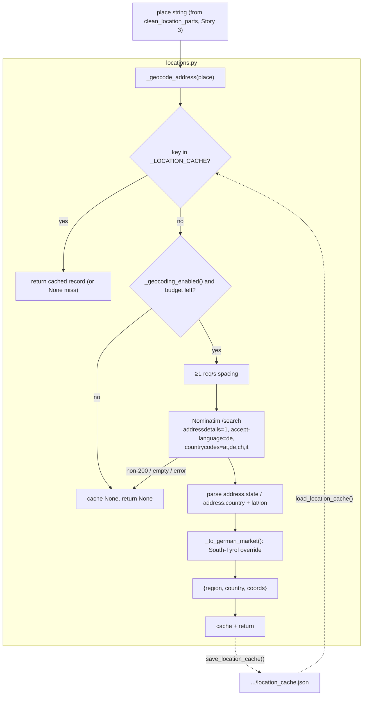

# Specification: Nominatim `addressdetails` resolver — region/country/coords per place

## Context

Story 2 of PRD [standardized-job-location](../../prds/standardized-job-location/prd.md)
([plan](../../prds/standardized-job-location/plan.md), revised **R1 — geocode-only**). The digest
([#109](https://github.com/EnnioTorre/dach-exec-job-alerts/issues/109)) shows locations with no region
or country (`Wels,`, `Niklasdorf,`). The feature standardizes every location to
`place, region, country`; this story builds the **sole resolver** that turns a cleaned place string
into its region, country, and coordinates.

Under R1 the bundled gazetteer was dropped (reviewer decision on PR #117). There is **no static
table** — region/country/coords come from **Nominatim `addressdetails=1`** only. This story adds the
`_geocode_address(place)` resolver to the shared module `.github/scripts/locations.py` (created in
Story 1). It is a thin extension of the existing, ADR-covered geocoding in `rank_jobs.py`
(`_geocode` / `_geocode_query`, [ADR-0001](../../../docs/adrs/ADR-0001-nominatim-geocoding.md)): same
endpoint and usage-policy discipline, but with `addressdetails=1` so the response carries
`address.state` and `address.country`, and a per-place cache that stores the full record (not just
coords).

**Where it sits in the stack:** Story 1 shipped the pure helpers (`clean_location_parts`,
`_haversine_km`, `_is_out_of_geo`, `PLACEHOLDER`). **This story (S2) adds the resolver.** Story 3
(`normalize-location-core`) will call `clean_location_parts` → `_geocode_address` (this story) →
`_haversine_km` → `_is_out_of_geo` to compose `normalize_location()`. Nothing imports `_geocode_address`
yet when this story merges.

Confirmed ground truth (read from `main`):
- `rank_jobs._geocode_query` ([rank_jobs.py](../../../.github/scripts/rank_jobs.py):497) is the single
  Nominatim lookup: `requests.get(_NOMINATIM_URL, params={q, format:json, limit:1,
  countrycodes:"at,de,ch,it", accept-language:"de"}, headers={User-Agent}, timeout=(3.05,10))`,
  returning `(lat, lon)` or `None`. **This story's resolver uses the same call plus
  `addressdetails: 1`** and reads `address.state` / `address.country` in addition to `lat`/`lon`.
- `rank_jobs._geocode` (rank_jobs.py:523) wraps it with: lowercased-key cache lookup, a
  `RANK_GEOCODE`/`_geocoding_enabled()` on-off switch, a `RANK_GEOCODE_MAX` (default 50) per-run
  budget, and ≥1 req/s spacing via `_last_geocode_ts`. This story mirrors that control flow with its
  **own** module-level cache/counter/timestamp (independent of rank's).
- `rank_jobs._load_geocode_cache` / `_save_geocode_cache` (549–584) persist the coord cache as
  `{key: [lat,lon] | null}` at `RANK_GEOCODE_CACHE_PATH` (default `/tmp/jobs/geocode_cache.json`).
  This story persists a **richer** record (region/country/coords) at a **separate** path.
- `locations.py` already defines `_DACH_COUNTRIES = {"österreich","deutschland","schweiz"}` and
  `_SOUTH_TYROL_REGION = "südtirol"` — reused to apply the South-Tyrol region rule.
- Nominatim with `accept-language=de` already returns the German exonym for `address.country`
  (`Österreich`, `Deutschland`, `Schweiz`, `Italien`) and for CH cantons / AT-DE Bundesländer in
  `address.state` — so the German-market form is mostly obtained for free; only South Tyrol needs a
  curated override (see Data Mappings).
- `test_rank_jobs.py` mocks Nominatim with a `_FakeResp(status, payload)` class and
  `monkeypatch.setattr(rank_jobs.requests, "get", …)` (lines 31, 438–465); the persisted cache is
  tested with `tmp_path` + `RANK_GEOCODE_CACHE_PATH` env (469–507). This story's tests follow the same
  shapes against `locations.requests` / `LOCATION_CACHE_PATH`.
- `conftest.py` puts `.github/scripts` on `sys.path`, so `import locations` works in tests.

## Dependencies

- **Blocked by:** `locations-gazetteer-cleaner` (Story 1) — same module/file (`locations.py`), strictly
  sequential; this story adds to it. (It reuses `_DACH_COUNTRIES` / `_SOUTH_TYROL_REGION` for the
  German-market mapping, though its core resolution is independent of the S1 helpers.)
- **Blocks:** `normalize-location-core` (Story 3) — `normalize_location()` resolves each cleaned place
  by calling this story's `_geocode_address`.

Independently deployable: pure addition to a module nothing imports yet; geocoding is gated
(`RANK_GEOCODE=false` disables), bounded, cached, and fully degrading — merging it changes no runtime
behaviour.

## Architecture Approach



`_geocode_address` returns `{"region": str, "country": str, "coords": (lat, lon)}` on success, or
`None` when geocoding is disabled, the budget is exhausted, or the lookup fails/returns nothing. The
persisted cache stores hits and misses so repeated places cost no new request and a miss is not
retried within the budget.

## Files to Modify

| File Path | Change Description | Target Function/Component |
|-----------|-------------------|---------------------------|
| `.github/scripts/locations.py` | Add the `requests`/`os`/`time`/`json`/`Path` imports, the Nominatim constants, the per-place location cache + budget state, and the `_geocode_address` resolver plus `load_location_cache` / `save_location_cache` and the German-market mapping helper. | new `_geocode_address`, `_to_german_market`, `load_location_cache`, `save_location_cache`, `_location_geocoding_enabled` |
| `.github/tests/test_locations.py` | Add a `TestGeocodeAddressDetails` class with the 5 plan tests; add a module-level `_FakeResp` helper (mirroring `test_rank_jobs.py`). | `TestGeocodeAddressDetails` |

No new file is created — the resolver extends the Story-1 module. (The gazetteer data file was removed
in Story 1; this story adds no config file.)

### Behaviour detail — `locations.py` additions

| Symbol | Signature | Behaviour |
|---|---|---|
| `_NOMINATIM_URL` | `str` | `"https://nominatim.openstreetmap.org/search"` (same as `rank_jobs`). |
| `_DEFAULT_GEOCODE_UA` | `str` | Descriptive User-Agent with contact URL (same string `rank_jobs` uses). |
| `_LOCATION_CACHE` | `dict[str, dict \| None]` | Module-level per-place cache, keyed by lowercased place. Value is `{"region","country","lat","lon"}` for a hit, `None` for a miss. Independent of `rank_jobs._GEOCODE_CACHE`. |
| `_loc_geocode_used`, `_last_loc_geocode_ts` | `int`, `float` | Module-level budget counter + last-request timestamp (independent of `rank_jobs`'s). |
| `_location_geocoding_enabled()` | `() -> bool` | `os.getenv("RANK_GEOCODE","true")` not in `{0,false,no}` — reuses the same operator switch as `rank_jobs`. |
| `_to_german_market(address)` | `(dict) -> (region, country)` | `country = address.get("country")` (German via `accept-language=de`); `region = address.get("state") or address.get("region") or PLACEHOLDER`. **South-Tyrol override:** when the country is Italy (`Italien`/`Italy`/`it`) and the address indicates the Bolzano/Bozen province or South Tyrol (e.g. `address.state`/`county`/`ISO3166-2-lvl4` contains `Südtirol`/`Bolzano`/`Bozen`/`BZ`), set `region = "Südtirol"` and keep `country = "Italien"`, so `_is_out_of_geo` accepts it. |
| `_geocode_address(place)` | `(str) -> dict \| None` | Cached, budgeted, rate-limited resolver. Lowercased-key cache lookup first; if enabled and under `RANK_GEOCODE_MAX` budget, space ≥1 req/s, call Nominatim with `addressdetails=1`, parse `address` + `lat`/`lon`, apply `_to_german_market`, build `{"region","country","coords":(lat,lon)}`, cache and return it. On disabled / exhausted / empty place / non-200 / empty result / any exception → cache `None` (for a real miss) and return `None`. **Never raises.** |
| `load_location_cache()` | `() -> None` | Load `{place: {region,country,lat,lon} \| null}` from `LOCATION_CACHE_PATH` (default `/tmp/jobs/location_cache.json`) into `_LOCATION_CACHE`; tolerate a missing/malformed file (never raise). Empty path disables disk I/O. Mirrors `rank_jobs._load_geocode_cache`. |
| `save_location_cache()` | `() -> None` | Serialize `_LOCATION_CACHE` to that path as `{place: {region,country,lat,lon} \| null}`, creating the dir. Tolerate `OSError`. Empty path = no-op. Mirrors `rank_jobs._save_geocode_cache`. |

**Business rules carried from the PRD/plan (make explicit, don't infer):**
- **Geocode-only** (R1): region/country/coords come from Nominatim `addressdetails`, never a table.
- **German-market local form** is the standard. `accept-language=de` yields it for country and most
  regions; the one curated override is **South Tyrol → `Südtirol` / `Italien`** (BAC-6 accepts it
  in-geography via region).
- **OSMF usage policy (ADR-0001):** descriptive `User-Agent`, **≥1 req/s** spacing, explicit timeout
  `(3.05, 10)`, results (incl. misses) cached. Bounded per run by `RANK_GEOCODE_MAX`.
- **Graceful degradation (BAC-9):** any failure, disablement, or budget exhaustion returns `None`;
  the caller (Story 3) then uses the placeholder for the unresolved parts. A geocoding outage never
  fails the run.
- **No ranking regression (BAC-9):** this story is unused at merge; it introduces no change to the
  existing `rank_jobs` geocoding or `_DACH_LOCATION_POINTS` distance fallback.
- **Budget independence:** this module keeps its own cache/counter/timestamp, so its `RANK_GEOCODE_MAX`
  budget is separate from the ranker's. The two stages run in separate processes (scrape/normalize vs
  rank), so the ≥1 req/s policy holds per process.

## Data and Contract Mappings

Nominatim Search response (one result object, `addressdetails=1`) → resolver record:

| Nominatim field | Resolver field | Type conversion | Notes (verified against `rank_jobs._geocode_query` + Nominatim docs) |
|---|---|---|---|
| `lat`, `lon` (top-level, strings) | `coords` | `(float(lat), float(lon))` | Same parse as `rank_jobs` (strings in payload). |
| `address.country` | `country` | str, as-is | German exonym via `accept-language=de` (`Österreich`/`Deutschland`/`Schweiz`/`Italien`). |
| `address.state` (fallback `address.region`) | `region` | str, else `PLACEHOLDER` | AT/DE Bundesland or CH Kanton; German via `accept-language=de`. Missing → `PLACEHOLDER`. |
| `address.state`/`county`/`ISO3166-2-lvl4` (South-Tyrol markers) + `country ∈ {Italien,Italy,it}` | `region` override | → `"Südtirol"` | The sole curated mapping; keeps `country = "Italien"` so `_is_out_of_geo` accepts it. |

Request params (extend `rank_jobs._geocode_query` with one key):
```
q=<place>  format=json  limit=1  addressdetails=1
countrycodes=at,de,ch,it  accept-language=de
headers: User-Agent=<descriptive UA>   timeout=(3.05, 10)
```

Persisted cache record (`LOCATION_CACHE_PATH`): `{ "<place lower>": {"region":str,"country":str,"lat":float,"lon":float} | null }`.

## Key Patterns to Follow

| Pattern | Reference Implementation |
|---------|------------------------|
| One Nominatim lookup (params, headers, timeout, degrade-to-None) | `rank_jobs.py:_geocode_query` (497) |
| Cached + budgeted + ≥1 req/s wrapper | `rank_jobs.py:_geocode` (523) |
| Persisted hit/miss cache (load/save, tolerant of malformed file, empty-path = no disk I/O) | `rank_jobs.py:_load_geocode_cache` / `_save_geocode_cache` (549–584) |
| Mocking Nominatim in tests (`_FakeResp`, `monkeypatch.setattr(mod.requests,"get",…)`, `tmp_path` + cache-path env) | `test_rank_jobs.py` (31, 438–465, 469–507) |
| Pure/structured helpers already in the module | `locations.py` (`_DACH_COUNTRIES`, `_SOUTH_TYROL_REGION`, `PLACEHOLDER`) |

## Existing Code to Reuse

| Existing Asset | Location | How to Reuse | Why Not Create New |
|---------------|----------|--------------|-------------------|
| `_geocode_query` call shape | `rank_jobs.py:497` | Copy the `requests.get` call; add `addressdetails:1`; additionally read `address` | Identical endpoint/policy already ADR-covered; only the extra param + address parse differ |
| `_geocode` control flow | `rank_jobs.py:523` | Mirror the cache-lookup → enabled → budget → spacing → call → cache sequence | Same bounded/rate-limited/degrading discipline is mandatory (ADR-0001) |
| `_load_geocode_cache` / `_save_geocode_cache` | `rank_jobs.py:549` | Mirror for the richer per-place record at a separate path | Same persistence/tolerance pattern; only the value shape differs |
| `_DACH_COUNTRIES`, `_SOUTH_TYROL_REGION`, `PLACEHOLDER` | `locations.py` | Reuse for the German-market mapping + South-Tyrol override + unknown-region fallback | Already the module's agreed vocabulary |
| `_FakeResp` test helper | `test_rank_jobs.py:31` | Re-declare the same tiny helper in `test_locations.py` | Local test double; trivially small |

*No existing asset already returns region+country+coords from `addressdetails` — `_geocode_address`
is genuinely new, but it is a thin, pattern-faithful extension of the ADR-0001 geocoding rather than a
new mechanism.*

## Verification Criteria

The five plan tests (Level `CT`, Type `Functional`). Network is mocked via
`monkeypatch.setattr(locations.requests, "get", …)` with a `_FakeResp` double (never a live call); the
persisted cache uses `tmp_path` + `LOCATION_CACHE_PATH`; the budget/enable use env + resetting the
module counters/cache in the test (as `test_rank_jobs.py` does with an autouse fixture).

### Component Tests (CT)

| Test Name | ITPF Test Type | What it verifies | Risk mitigated | BAC |
|-----------|----------------|------------------|----------------|-----|
| `test_addressdetails_resolves_region_country_coords_for_place` | Functional | A mocked `addressdetails` payload (`address.state`/`address.country` + `lat`/`lon`) ⇒ `_geocode_address` returns `{region, country, coords}` in German-market form | A place (mocked) resolves region+country+coords — a place stays region/country-less | BAC-3 |
| `test_geocode_failure_degrades_to_none` | Functional | A non-200 / request exception / empty result ⇒ `_geocode_address` returns `None` and never raises | geocode returns `None` on failure, no raise — a geocoding outage breaks the run | BAC-9 |
| `test_location_cache_round_trip_persists_hits_and_misses` | Functional | `save_location_cache()` then `load_location_cache()` preserves a hit record and a `None` miss | hits + misses survive save/reload — re-geocoding wastes budget / non-reproducible | BAC-9 |
| `test_addressdetails_cached_place_makes_no_second_call` | Functional | A place already in `_LOCATION_CACHE` ⇒ a second `_geocode_address` makes no HTTP call (mock set to raise) | a cached place ⇒ no network call — wasted Nominatim calls / policy breach | BAC-9 |
| `test_addressdetails_respects_per_run_budget` | Functional | With `RANK_GEOCODE_MAX=1`, a second distinct place ⇒ `None` with no further call | beyond budget ⇒ no further call — unbounded geocoding breaches OSM policy | BAC-9 |

### System / Integration Tests (ST · SIT)
None — resolver is exercised in isolation; wiring into scrape/rank is Stories 4–5.

### Acceptance Verification (UAT)
None at this level.

**Manual check (optional):** with `RANK_GEOCODE=true`, `python3 -c "import sys; sys.path.insert(0,'.github/scripts'); import locations; print(locations._geocode_address('Graz'))"` (one live Nominatim call) should print a record with `region='Steiermark'`, `country='Österreich'`.

## Blast Radius

- **Files directly modified:** `.github/scripts/locations.py`, `.github/tests/test_locations.py` (2 files).
- **Dependent systems affected:** none yet — `_geocode_address` is unused until Story 3 imports it.
  Outbound dependency: OpenStreetMap Nominatim (same service as `rank_jobs`, ADR-0001).
- **Regression risk:** minimal — purely additive; it does not touch `rank_jobs`'s geocoding, the
  existing `_GEOCODE_CACHE`, or `_DACH_LOCATION_POINTS`. The new module-level geocode state is
  independent. The CI `pytest` + `quality` (ruff advisory, gitleaks) workflows run on the changes.
  Small-PR rule: 2 code files, well within ≤3 files; keep the diff ≤200 lines (the resolver + cache +
  5 tests are comfortably under).
- **ADR note (plan External Action Item):** append a line to
  [ADR-0001](../../../docs/adrs/ADR-0001-nominatim-geocoding.md) recording the `addressdetails=1`
  extension (same endpoint, one extra parameter, no new tech). May land with or just after this story;
  not a code dependency.

## Security Surface

- **New attack surface:** one additional outbound HTTP GET to a **fixed** URL (`_NOMINATIM_URL`); the
  place string is passed as a URL-encoded query parameter by `requests` (no URL construction from
  input), so there is no SSRF or injection vector. No inbound surface.
- **Data sensitivity:** only public city/region strings scraped from job postings are sent — no PII,
  credentials, or financial data (per ADR-0001).
- **Auth/authz changes:** none; the public endpoint needs no key or secret.
- **Input validation:** empty/whitespace place ⇒ `None` without a call; all response parsing is wrapped
  so malformed/hostile payloads degrade to `None` (never raise, never trusted beyond `lat`/`lon`/
  `address` string fields).

| What it must do | Verified by |
|---|---|
| Degrade to `None` (never raise) on any non-200 / exception / empty result | `test_geocode_failure_degrades_to_none` |
| Never exceed the per-run Nominatim budget | `test_addressdetails_respects_per_run_budget` |
| Not re-call Nominatim for an already-resolved place (caching per OSM policy) | `test_addressdetails_cached_place_makes_no_second_call` |

## Test Data Requirements

- **Fixtures:** none on disk — tests build inline `_FakeResp` payloads and use `tmp_path` for the cache.
- **Edge-case data:**
  - A hit payload: `[{"lat":"47.0707","lon":"15.4395","address":{"state":"Steiermark","country":"Österreich"}}]`.
  - A South-Tyrol payload: `address` with `country:"Italien"` and a Bolzano/Bozen/Südtirol marker ⇒ `region="Südtirol"`.
  - Failure shapes: `status=500`, `requests.RequestException`, and `[]` (empty) ⇒ `None`.
  - Cache round-trip: one hit record + one `None` miss.
  - Budget: `RANK_GEOCODE_MAX=1` with two distinct places.

## Out of Scope

- `normalize_location()` (compose place/region/country/display, nearest-to-Vienna, placeholder) — Story 3.
- Any **use** of `_geocode_address` by scrape / rank / digest — Stories 4–6.
- Changing `rank_jobs`'s existing geocoding, cache, or `_DACH_LOCATION_POINTS` — untouched here.
- A shared cross-module geocode budget/cache — deliberately independent for now; a later cleanup could
  unify `rank_jobs` and `locations` geocoding.
- Restoring the location cache across daily runs via GitHub Actions cache (like the geocode cache) —
  a wiring concern for the workflow, handled when Story 4 puts the resolver on the hot path.
