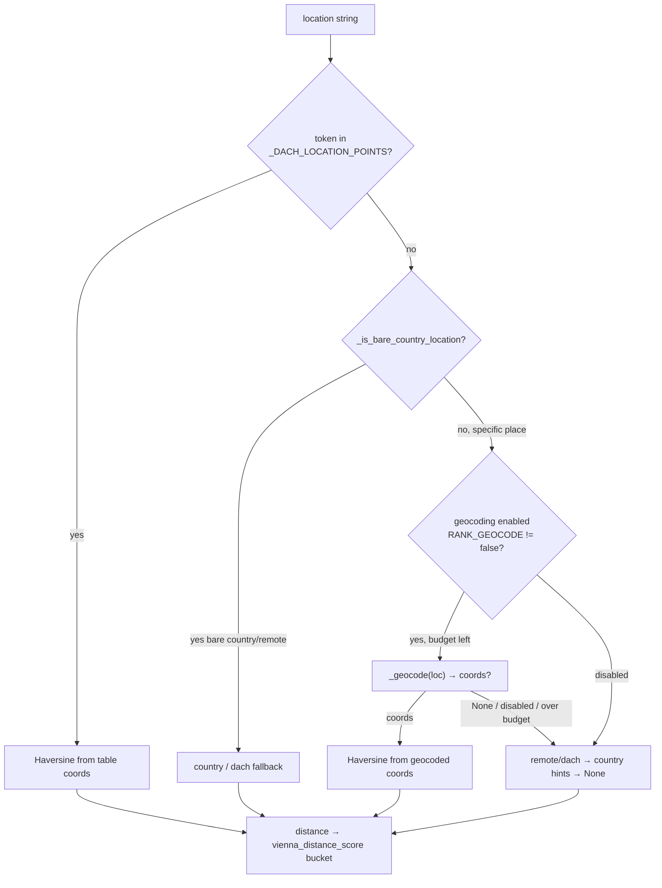

# Specification: Geocode arbitrary locations into the Vienna-distance score

## Context

This is Story 2 of PRD [precise-location-ranking](../../prds/precise-location-ranking/prd.md) and the
half that actually delivers precise ranking. Story 1 (merged, PR #108) now emits specific
city/region strings into `location`; this story turns any such string into a real distance from
Vienna via **OpenStreetMap Nominatim** geocoding, instead of the coarse per-country constant used
today.

Confirmed ground truth (read from code):
- `_distance_from_vienna_km(location)` ([rank_jobs.py](../../../.github/scripts/rank_jobs.py):471)
  lowercases the string, returns a Haversine distance for any **table** token in `_DACH_LOCATION_POINTS`
  (substring match), then `remote`/`dach` → 500 km, then country hints
  (`_AUSTRIA_HINTS` etc.) → `_COUNTRY_DISTANCE_FALLBACK` (AT 280 / DE 560 / CH 700 / IT 400), else
  `None`. `vienna_distance_score` buckets the distance (≤25→5.0 … >900→1.8; `None`→2.4).
- `rank_jobs.py` is currently **pure and offline** — it imports `json/os/re/math/…` but **not
  `requests`**, and its tests state "no mocking is needed." This story introduces the **first**
  network call into the ranking stage.
- `score_job` ([rank_jobs.py](../../../.github/scripts/rank_jobs.py):600) =
  `0.35·vienna_distance_score + 0.35·language_score + 0.30·it_management_focus_score`, clamped [1,5].
  Only the `location` input accuracy changes here; weights are untouched.

### Decisions made (two diverge from the plan — see Out of Scope / Deviations)

- **Geocoding is ON by default** with a **disable flag** (`RANK_GEOCODE=false` turns it off) — per the
  user's decision, overriding the plan's enable-flag/dark-launch wording.
- **Activate in this PR** by adding geocoding env to the workflow's rank steps — overriding the plan's
  "rank_jobs.py + test only" scope.
- **Self-contained geocoder** in `rank_jobs.py` (own `requests` call, timeout, `User-Agent`, ≥1 req/s
  spacing, cache, budget) rather than importing the rate limiter from the 2,300-line `scrape_jobs.py`
  — avoids heavy coupling. No BAC impact.
- **Bare-country guard**: a location that is only a country/marker (`"Austria"`, `"remote"`, `.at`)
  keeps the country fallback and is **not** geocoded — preserves existing behaviour/tests and avoids
  wasting the budget on country centroids.

## Dependencies

- **Blocked by:** none (Story 1 is merged; this story consumes the `location` string it produces but
  works on whatever strings exist).
- **Blocks:** none.
- **Compliance dependency:** the **Nominatim project ADR** (CIG returned `NO_COVERAGE`) must be
  authored because this PR activates Nominatim in production. Tracked as an External Action Item in
  the plan; author it alongside this change (not created by this spec).

## Architecture Approach

New order inside `_distance_from_vienna_km`: table → **(bare-country → fallback)** → **geocode specific
strings (if enabled & within budget)** → remote/dach → country hints → `None`. Everything degrades to
today's fallback on any miss, so the run never fails on geocoding (BAC-5).

## Files to Modify

| File Path | Change Description | Target |
|-----------|-------------------|--------|
| `.github/scripts/rank_jobs.py` | Add `import requests` and `import time`; add module globals `_GEOCODE_CACHE: dict[str, tuple[float,float] \| None] = {}`, `_geocode_used = 0`, `_last_geocode_ts` | module scope |
| `.github/scripts/rank_jobs.py` | New `_is_bare_country_location(loc) -> bool` — true for empty/country-only/remote/dach/country-code strings (reuse the existing `_*_HINTS` words) | new helper near the hints |
| `.github/scripts/rank_jobs.py` | New `_geocode_query(location) -> tuple[float,float] \| None` — single Nominatim HTTP call (see Behaviour detail); returns `None` on any failure, never raises | new helper |
| `.github/scripts/rank_jobs.py` | New `_geocode(location) -> tuple[float,float] \| None` — cache → enable-flag → budget → ≥1 req/s spacing → `_geocode_query`; caches misses | new helper |
| `.github/scripts/rank_jobs.py` | Wire geocoding into `_distance_from_vienna_km` per the flow above (bare-country guard, geocode specific strings, keep all existing fallbacks) | `_distance_from_vienna_km` (471) |
| `.github/tests/test_rank_jobs.py` | Add a module-level **autouse** fixture disabling geocoding (`RANK_GEOCODE=false`) so existing pure tests stay offline; add new geocode test class | new fixture + `class Test…` |
| `.github/workflows/dach-exec-job-alerts.yml` | Add env to the **Rank jobs** / **Re-rank** steps: `RANK_GEOCODE_MAX` and a descriptive `RANK_GEOCODE_USER_AGENT` (geocoding is on by default; UA satisfies the OSM usage policy) | `Rank jobs`, `Re-rank after second pass` steps |

No new files. No change to `create_issue.py`, `scrape_jobs.py`, or `sources.json`.

### Behaviour detail — `_geocode_query(location)`

- `GET https://nominatim.openstreetmap.org/search` with params `q=<location>`, `format=json`,
  `limit=1`, `countrycodes=at,de,ch,it` (DACH + South Tyrol, matching the project's scope),
  `accept-language=de`.
- Headers: `User-Agent` from `RANK_GEOCODE_USER_AGENT` env, default a descriptive string with a
  contact URL (e.g. `dach-exec-job-alerts/1.0 (+https://github.com/EnnioTorre/dach-exec-job-alerts)`)
  — **required** by the OSM Nominatim usage policy.
- `timeout=(<connect>, <read>)` explicit (e.g. `(3.05, 10)`). On any exception, non-200, or empty
  array → return `None` (never raise). On success → `(float(data[0]["lat"]), float(data[0]["lon"]))`.

### Behaviour detail — `_geocode(location)`

- Normalize key (lower/strip). If key in `_GEOCODE_CACHE` → return cached (incl. cached `None`).
- If disabled (`os.getenv("RANK_GEOCODE","true").lower() in {"0","false","no"}`) → return `None`
  **without** touching the cache or budget. *(The call site also guards this; double-guarding is fine.)*
- If `_geocode_used >= int(os.getenv("RANK_GEOCODE_MAX","50"))` → return `None`.
- Enforce ≥1 req/s: if `< 1.0s` since `_last_geocode_ts`, `time.sleep` the remainder (OSM policy).
- Increment `_geocode_used`, update `_last_geocode_ts`, call `_geocode_query`, cache the result
  (including `None`), return it.

### Behaviour detail — `_is_bare_country_location(location)`

Normalized (lower/strip) value is in a bare set: `""`, `austria`, `österreich`, `osterreich`,
`germany`, `deutschland`, `switzerland`, `schweiz`, `italy`, `italia`, `dach`, `remote`,
`remote (dach)`, `at`, `de`, `ch`, `it`, `.at`, `.de`, `.ch`, `.it`. Anything carrying a specific
place (`"Graz"`, `"Tyrol, Austria"`, `"South Tyrol, Italy"`) returns `False` and is eligible for
geocoding.

## Key Patterns to Follow

| Pattern | Reference Implementation |
|---------|------------------------|
| Bounded, cached enrichment (cache → budget → call → cache incl. miss; never raise) | `.github/scripts/scrape_jobs.py:_fetch_job_page_language` (≈1752) and the Story-1 `_fetch_job_page_location` |
| Haversine distance + bucket mapping | `.github/scripts/rank_jobs.py:_haversine_km` / `vienna_distance_score` |
| Pre-emptive request spacing for a throttled host (≥Ns between calls via a module timestamp) | `scrape_jobs.py` `_SEARXNG_MIN_SPACING` / `_last_searxng_call` (SearXNG 5s spacing) |
| Enable/budget via `*_MAX` env + module counter | `SCRAPER_PAGE_LANG_ENRICH_MAX` / `_page_lang_enrich_used` in `scrape_jobs.py` |
| Test stubbing of a module function/env | `monkeypatch.setattr(module, …)` / `monkeypatch.setenv(…)` — used throughout `test_scrape_jobs.py` (e.g. `TestMarketLangHint`) |

## Existing Code to Reuse

| Existing Asset | Location | How to Reuse | Why Not Create New |
|---------------|----------|--------------|-------------------|
| `_haversine_km` | `rank_jobs.py:461` | Compute distance from geocoded coords, same as table coords | Already the project's distance primitive |
| `_DACH_LOCATION_POINTS` | `rank_jobs.py:417` | First-checked fast-path cache (table) before geocoding | Hand-curated hot cities; keeps BAC-6 exact and saves calls |
| `_COUNTRY_DISTANCE_FALLBACK` + `_*_HINTS` | `rank_jobs.py:448` | The degradation path when geocoding is off/fails; also feeds `_is_bare_country_location` | Encodes the existing country-fallback policy |
| `vienna_distance_score` buckets | `rank_jobs.py` | Unchanged — consumes the (now geocoded) distance | The scoring curve is not changing |
| Bounded-fetch/cache/budget pattern | `scrape_jobs.py:_fetch_job_page_language` | Structural template for `_geocode` | Proven pattern; mirror, don't reinvent |
| `requests` dependency | installed in CI (`pip install … requests`) | `import requests` in `rank_jobs.py` | Already a project dependency; no new library |

## Verification Criteria

All plan tests carried over verbatim (Level `CT`, Type `Functional`). The rank suite is pure today,
so a module-level **autouse fixture** sets `RANK_GEOCODE=false` to keep existing tests offline; the
new tests re-enable geocoding and stub `_geocode` / `_geocode_query` (never live Nominatim).

### Component Tests (CT)

| Test Name | ITPF Test Type | What it verifies | Risk mitigated | BAC |
|-----------|----------------|------------------|----------------|-----|
| `test_known_city_still_scores_from_table_without_geocoding` | Functional | A city in `_DACH_LOCATION_POINTS` scores from the table and `_geocode` is **not** called (stub `_geocode` to raise) | Known-city scores drift; a working ranking regresses | BAC-6 |
| `test_arbitrary_city_geocoded_to_distance_bucket` | Functional | A non-table city with `_geocode` stubbed to fixed coords maps to the expected distance bucket | Off-list cities stay at the coarse country score; ranking can't discriminate | BAC-2 |
| `test_two_cities_same_country_score_by_distance` | Functional | Two non-table same-country cities with different stubbed coords get different location scores | Near and far roles rank equally; the reader's top picks are wrong | BAC-2 |
| `test_region_only_uses_region_coords_over_country_fallback` | Functional | A region string (e.g. `"Tyrol, Austria"`) with stubbed coords scores from the region, not the 280 km country fallback | Region-only rows are needlessly demoted to the coarse country estimate | BAC-4 |
| `test_geocode_failure_falls_back_to_country_distance` | Functional | When `_geocode` returns `None` for a city+country string, the score equals the country fallback and nothing raises | A geocoding outage breaks scoring and no digest is produced | BAC-5 |
| `test_geocode_result_cached_second_call_not_refetched` | Functional | Two `_geocode` calls for the same location invoke `_geocode_query` (stubbed counter) **once** | Duplicate lookups waste the Nominatim budget and make runs non-reproducible | BAC-7 |
| `test_geocode_respects_per_run_budget` | Functional | With `RANK_GEOCODE_MAX=1`, a second distinct location is not queried and falls back | Unbounded geocoding breaches OSM usage policy and risks a ban | BAC-2 |
| `test_geocoding_disabled_preserves_current_scores` | Functional | With `RANK_GEOCODE=false`, a would-be-geocoded city falls back exactly as today (no `_geocode` call) | No safe rollback path; a bad geocoding rollout can't be turned off | BAC-6 |

### System / Integration Tests (ST · SIT)
None — component-level only; Nominatim is stubbed. The live Nominatim path is exercised only in the
real workflow run, not in CI.

### Acceptance Verification (UAT)
None automated here.

**Manual check (optional):** run `python3 .github/scripts/rank_jobs.py` locally against a
`jobs_raw.json` containing a non-table city (geocoding on, network available) and confirm its
`vienna_distance_score` reflects true proximity rather than the country constant.

## Blast Radius

- **Files directly modified:** `.github/scripts/rank_jobs.py`, `.github/tests/test_rank_jobs.py`,
  `.github/workflows/dach-exec-job-alerts.yml`.
- **Dependent systems affected:** introduces outbound HTTPS to `nominatim.openstreetmap.org` during
  the rank stage. `create_issue.py` unaffected. Digest **ordering will change** for jobs whose
  geocoded location differs from the old country constant — that is the intended effect.
- **Regression risk:**
  - Existing pure distance/score tests — guarded by the autouse disable fixture **and** the
    bare-country guard (so `"Austria"`/`"Österreich"`/`"remote"`/table cities keep today's scores
    without any network). BAC-6 pins known-city behaviour.
  - New network dependency in the previously-offline ranker — bounded by `RANK_GEOCODE_MAX`,
    cached, ≥1 req/s spaced, explicit timeout, and fully degrading (BAC-5) so a Nominatim outage
    cannot fail the run.
  - First `import requests` in `rank_jobs.py` — the dependency is already installed in CI and local
    dev; `requests` must be importable when running the ranker.

## Security Surface

New **outbound** HTTPS to a public geocoding service. No inbound surface, no credentials/secrets, no
auth change. Only city/region strings are sent (no PII). The implementation must: set a descriptive
`User-Agent` (OSM policy), set an explicit connect/read timeout, bound calls via `RANK_GEOCODE_MAX`,
and treat any failure as non-fatal (graceful fallback).

| What it must do | Verified by |
|---|---|
| Fall back to the country distance and never raise when geocoding fails/outage | `test_geocode_failure_falls_back_to_country_distance` |
| Never exceed the per-run geocoding budget (OSM rate policy) | `test_geocode_respects_per_run_budget` |
| Be fully disableable for rollback | `test_geocoding_disabled_preserves_current_scores` |

*(User-Agent and timeout are OSM-policy/resilience requirements asserted by the Nominatim project ADR
and exercised implicitly by the stubbed tests; the live header/timeout are a config concern verified
in the workflow run, not a unit assertion.)*

## Test Data Requirements

- **Fixtures:** none on disk — tests build small job/location strings inline and stub `_geocode` /
  `_geocode_query` via `monkeypatch`.
- **Edge-case data:** a table city (`"Graz"`), a non-table city (`"Bregenz"`), two non-table cities
  with different coords, a region (`"Tyrol, Austria"`), a bare country (`"Austria"`), and a
  `_geocode→None` case (`"Nowhere, Austria"`).
- **Seed data:** none.

## Out of Scope

- Scrape-side location capture/enrichment — delivered by Story 1 (`location-capture-scrape`, merged).
- Changing the scoring **weights** or buckets — only the `location` input accuracy changes.
- Any change to `create_issue.py` (renders `location`/score as-is).
- Authoring the **Nominatim project ADR** — required (CIG `NO_COVERAGE`) and tracked as an External
  Action Item; written by the team / at finalise time, not by this spec.

### Deviations from the plan (recorded for traceability)

1. **Flag polarity:** plan said enable-flag/dark-launch; implemented as **disable flag, default ON**
   (user decision).
2. **Scope:** plan scoped Story 2 to `rank_jobs.py` + test; this PR **also edits the workflow** to
   activate geocoding now (user decision). Blast radius updated accordingly.
3. **Rate limiting:** plan said "reuse the existing per-domain limiter"; implemented **self-contained**
   in `rank_jobs.py` to avoid coupling to `scrape_jobs.py`. No BAC impact.
