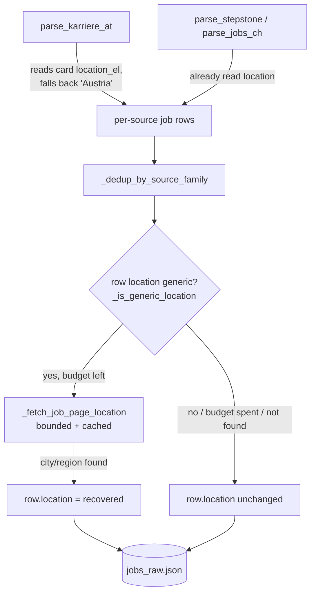

# Specification: Capture a specific city at scrape time

## Context

The digest ranks postings by distance from Vienna, but many rows carry only a bare country, so the
ranking is flat within a country and the reader cannot judge relevance (PRD
[precise-location-ranking](../../prds/precise-location-ranking/prd.md), BAC-1, BAC-3). The root cause
on the scrape side: `parse_karriere_at` hardcodes `"location": "Austria"` and never inspects the card
for a location element, unlike `parse_stepstone` (reads `data-at="job-item-location"`) and
`parse_jobs_ch` (reads a `location|place` element). This story makes the scrape stage emit a specific
city/region into the `location` field so a richer string flows unchanged into ranking
([rank_jobs.py](../../../.github/scripts/rank_jobs.py)) and into the digest
(`create_issue.py:118` renders `j.get("location")` verbatim — **no digest change needed**).

Two deliverables, both inside `scrape_jobs.py`:
1. Fix `parse_karriere_at` to read the card's location element (give it the lookup its sibling
   parsers already have), falling back to `"Austria"` only when absent.
2. Add a **bounded, cached job-page location-enrichment** that, for rows whose `location` is still
   country-only or empty, fetches the job page once (within a per-run budget) to recover a
   city/region — mirroring the existing `_fetch_job_page_language` pattern exactly.

This is the scrape half of the feature. Story 2 (`geocode-vienna-distance`) turns whatever location
string exists into a precise distance; the two stories touch disjoint files and are parallel.

## Dependencies

- **Blocked by:** none.
- **Blocks:** none. (`geocode-vienna-distance` consumes the `location` field but does not require this
  story — it geocodes whatever strings exist today; this story makes more of those strings specific.)

This story is independently deployable: a more specific `location` improves known-city scoring
immediately and degrades to today's behaviour for anything unrecognised.

## Architecture Approach

Control flow:
- **Parser fix** happens at parse time (per row).
- **Location enrichment** runs as a single post-dedup pass in `main()` over the rows that will be
  written, so budget is spent only on surviving rows. Every helper degrades gracefully (returns
  `None` / leaves the row unchanged; never raises), consistent with the "parsers never raise"
  convention.

## Files to Modify

| File Path | Change Description | Target Function/Component |
|-----------|-------------------|---------------------------|
| `.github/scripts/scrape_jobs.py` | Add a `location_el` lookup to the card loop; use `_text(location_el) or "Austria"` instead of the hardcoded `"Austria"` | `parse_karriere_at` |
| `.github/scripts/scrape_jobs.py` | Add module globals `_PAGE_LOCATION_CACHE: dict[str, str] = {}` and `_location_enrich_used = 0`, next to the existing `_PAGE_LANG_CACHE` / `_page_lang_enrich_used` (≈L210) | module scope |
| `.github/scripts/scrape_jobs.py` | New helper `_fetch_job_page_location(url) -> str \| None` mirroring `_fetch_job_page_language`: cache-check → budget-check (`SCRAPER_PAGE_LOCATION_ENRICH_MAX`, default 40) → `fetch(url, retries=1)` → extract location from the page → cache + return; `None` on any failure | new function near `_fetch_job_page_language` (≈L1756) |
| `.github/scripts/scrape_jobs.py` | New helper `_is_generic_location(location) -> bool` — true for empty or country-/remote-only strings with no specific place | new function (near the parsers or helpers) |
| `.github/scripts/scrape_jobs.py` | New helper `_enrich_locations(jobs) -> None` — in-place pass: for each row where `_is_generic_location(row["location"])`, call `_fetch_job_page_location(application_url or source_url)` within budget and set `row["location"]` when a value is returned; gated by `SCRAPER_PAGE_LOCATION_ENRICH` (default true) | new function |
| `.github/scripts/scrape_jobs.py` | Call `_enrich_locations(all_jobs)` in `main()` immediately after `all_jobs = _dedup_by_source_family(all_jobs)` and before `deduped_source_stats` is computed | `main()` (≈L2300) |
| `.github/tests/test_scrape_jobs.py` | Add test classes for the parser fix and the enrichment helper (see Verification) | new `class Test…` blocks |

No new files. No change to `create_issue.py` or `rank_jobs.py`.

### Behaviour detail — `_fetch_job_page_location(url)`

Extraction order on the fetched page (design, not implementation):
1. **JSON-LD `JobPosting`** via the existing `extract_jsonld_jobs(html)` → `jobLocation.address`:
   prefer `addressLocality` (city); else `addressRegion` (region/state). This is the same source
   `normalize_jsonld` already reads for location.
2. **Visible location element** fallback: an element whose class/`data-at` matches
   `location|ort|standort|place` (same shape the card parsers use).
3. Return the first non-empty specific string; otherwise `None`.

Budget/caching/flags mirror `_fetch_job_page_language` verbatim:
- per-URL cache `_PAGE_LOCATION_CACHE` (store `""` for a failed/empty attempt so it is not retried);
- per-run counter `_location_enrich_used` capped by `SCRAPER_PAGE_LOCATION_ENRICH_MAX` (default `40`);
- a failed `fetch` caches `""` and returns `None`;
- the whole pass is skipped when `SCRAPER_PAGE_LOCATION_ENRICH` is not truthy.

### Behaviour detail — `_is_generic_location(location)`

Returns `True` when the normalized (lower/stripped) location is empty, or is exactly one of the
project's country/region-less markers: `austria`, `österreich`, `germany`, `deutschland`,
`switzerland`, `schweiz`, `italy`, `italia`, `dach`, `remote`, `remote (dach)`, or a bare country code
(`.at`/`.de`/`.ch`/`.it` with nothing else). Any string carrying a specific place (e.g. `"Graz"`,
`"Wien, Österreich"`, `"Munich, Germany"`) returns `False` and is left untouched — this is what keeps
already-specific rows out of the enrichment path and preserves the no-regression constraint.

## Key Patterns to Follow

| Pattern | Reference Implementation |
|---------|------------------------|
| Bounded, cached page-fetch enrichment (cache → budget → fetch → cache result; never raise) | `.github/scripts/scrape_jobs.py:_fetch_job_page_language` (≈L1756) |
| Enrichment enable flag + per-run cap env vars | `SCRAPER_PAGE_LANG_ENRICH` / `SCRAPER_PAGE_LANG_ENRICH_MAX` usage in `_market_lang_hint` (≈L1800) |
| Reading a location element from a card | `.github/scripts/scrape_jobs.py:parse_stepstone` (`data-at="job-item-location"`) and `parse_jobs_ch` (`class=location|place`) |
| Pulling location from JSON-LD `jobLocation.address` | `.github/scripts/scrape_jobs.py:normalize_jsonld` / `extract_jsonld_jobs` |
| Module-level cache + per-run counter globals | `_PAGE_LANG_CACHE` / `_page_lang_enrich_used` (≈L210) |

## Existing Code to Reuse

| Existing Asset | Location | How to Reuse | Why Not Create New |
|---------------|----------|--------------|-------------------|
| `_fetch_job_page_language` | `scrape_jobs.py:~1756` | Copy its structure for `_fetch_job_page_location` (same cache/budget/fetch/degrade shape) | It is the exact bounded-fetch pattern; only the extracted field differs |
| `extract_jsonld_jobs` | `scrape_jobs.py:~932` | Call to get `JobPosting` dicts from the fetched page | Already parses JSON-LD robustly; re-parsing would duplicate it |
| `normalize_jsonld` (location extraction) | `scrape_jobs.py:~955` | Reference for reading `jobLocation.address` → locality/region | Encodes how this project reads JSON-LD addresses |
| `_text` | `scrape_jobs.py` | Extract/clean text from the card location element | Standard card-text helper used by every parser |
| `fetch` | `scrape_jobs.py:~467` | The rate-limited, SSL-aware HTTP getter used by `_fetch_job_page_location` | Enforces the per-domain `TokenBucket` and CA-bundle handling |
| `_dedup_by_source_family` | `scrape_jobs.py` | Enrichment pass runs immediately after it | Defines the row set to enrich |

## Verification Criteria

All five tests are from the plan's Test Plan, carried over verbatim (Level `CT`, Type `Functional`).
Network is stubbed with `monkeypatch.setattr(scrape_jobs, …)` and env toggled with
`monkeypatch.setenv(…)` — the suite's established mechanism (see `TestMarketLangHint`,
`TestDetectJobLanguage`). No live HTTP.

### Component Tests (CT)

| Test Name | ITPF Test Type | What it verifies | Risk mitigated | BAC |
|-----------|----------------|------------------|----------------|-----|
| `test_parse_karriere_at_uses_card_city_when_present` | Functional | Parsing a Karriere.at card whose HTML exposes a city yields that city in `location`, not `"Austria"` | Reader cannot judge relevance; ranking stays flat across all AT jobs | BAC-1 |
| `test_parse_karriere_at_falls_back_to_austria_when_no_city` | Functional | A Karriere.at card with no location element yields `location == "Austria"` (no crash, no empty string) | A parser change silently drops location entirely, breaking every AT row | BAC-1 |
| `test_location_enrichment_recovers_city_for_country_only_row` | Functional | For a row with a generic/country `location`, the pass calls `_fetch_job_page_location` (monkeypatched to return a city) and sets `row["location"]` to that city | Jobs stay country-generic forever; the precision work delivers nothing | BAC-3 |
| `test_location_enrichment_respects_per_run_budget` | Functional | Once `_location_enrich_used` reaches `SCRAPER_PAGE_LOCATION_ENRICH_MAX`, no further fetch is attempted and remaining rows keep their location | Unbounded fetching blows up runtime and trips rate limits / 429s | BAC-3 |
| `test_location_enrichment_returns_none_on_fetch_failure` | Functional | When `fetch` (monkeypatched) fails, `_fetch_job_page_location` returns `None`, the row keeps its country location, and nothing raises | One bad page aborts the whole scrape, producing no digest | BAC-5 (fetch side) |

### System / Integration Tests (ST · SIT)
None — this story is component-level only (mocked network).

### Acceptance Verification (UAT)
None at this level — BAC-1's end-to-end visibility in the digest is observable once this story and the
digest's existing `location` render combine; it is not separately automated here.

**Manual check (optional):** run `python3 .github/scripts/scrape_jobs.py` locally and confirm
`/tmp/jobs/jobs_raw.json` shows specific cities for Karriere.at rows instead of `"Austria"`.

## Blast Radius

- **Files directly modified:** `.github/scripts/scrape_jobs.py`, `.github/tests/test_scrape_jobs.py`.
- **Dependent systems affected:** none external. Downstream in-repo consumers benefit without change:
  `rank_jobs.py` (`_distance_from_vienna_km` sees more specific strings), `create_issue.py` (Location
  column shows the city automatically). `jobs_raw.json` row content becomes more specific (no shape
  change; `location` is already a string field).
- **Regression risk:**
  - The `parse_karriere_at` edit must not change behaviour when no location element exists — the
    `test_…_falls_back_to_austria…` test guards this. There are currently no `parse_karriere_at`
    unit tests to break (confirmed by grep), so the new tests are additive.
  - The enrichment pass must only touch **generic** rows (`_is_generic_location`), never specific
    ones — this preserves the PRD's no-regression constraint and keeps Story 2's table cities intact.
  - Added network fetches are bounded by `SCRAPER_PAGE_LOCATION_ENRICH_MAX` and routed through the
    existing rate limiter, so the pre-emptive-throttling guarantee is preserved.

## Security Surface

This story adds **outbound** HTTP fetches of public job pages (same class of request the scraper
already makes) through the existing rate-limited, SSL-aware `fetch`. No new inbound surface, no
credentials, no PII (job-posting pages only), no auth/authz change. The only new "input" is untrusted
HTML parsed by the already-used BeautifulSoup/JSON-LD path, which the `parse_*` functions already
handle defensively (never raise). No dedicated Security Surface controls are required beyond the
graceful-degradation already verified by `test_location_enrichment_returns_none_on_fetch_failure`.

## Test Data Requirements

- **Fixtures needed:** small inline Karriere.at card HTML snippets — one with a location element
  (e.g. "Graz"), one without — passed directly to `parse_karriere_at` (inline strings, as the
  existing scrape tests do).
- **Edge case data:** a row whose `location` is `"Austria"` / `""` (generic → enriched) vs one whose
  `location` is `"Graz"` (specific → left untouched); a monkeypatched `_fetch_job_page_location`
  returning a city, and a monkeypatched `fetch` returning `None` for the failure path.
- **Seed data:** none.

## Out of Scope

- Geocoding location strings to coordinates and the Vienna-distance change — that is Story 2
  (`geocode-vienna-distance`), in `rank_jobs.py`.
- Any change to `create_issue.py` (it already renders `location` verbatim).
- Bespoke city extraction for `parse_stepstone` / `parse_jobs_ch` beyond what they already do, and for
  LinkedIn/Google-SERP parsers — those rely on the shared enrichment pass, not new per-parser logic.
- The Nominatim project ADR (tracked as an External Action Item in the plan).
