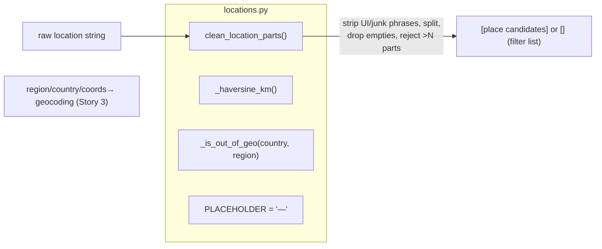

# Specification: Locations module foundation — cleaner, geography predicate, Haversine

## Context

Story 1 of PRD [standardized-job-location](../../prds/standardized-job-location/prd.md). The digest
([#109](https://github.com/EnnioTorre/dach-exec-job-alerts/issues/109)) shows malformed, non-uniform
locations (trailing commas, filter lists like all Austrian states, UI text such as `Suche erweitern`,
out-of-geography rows like San Francisco). The feature fixes this with a shared `normalize_location()`
(built in Stories 2–3) wired into scrape/rank/digest (Stories 4–6).

**This story builds only the pure foundation** of a new shared module `.github/scripts/locations.py`:
a string **cleaner** (junk/UI/filter-list rejection), a Haversine helper, an out-of-geography
predicate, and the placeholder constant. **Region/country/coordinates are resolved by geocoding**
(Nominatim `addressdetails`, Story 3) — there is **no bundled gazetteer table**. **Nothing imports
this module yet** — `normalize_location` (Story 2) and the geocode resolver (Story 3) are added to this
same module next; scrape/rank/digest wiring is Stories 4–6.

Confirmed ground truth (read from `main`):
- `_haversine_km` (rank_jobs.py:587) is the distance primitive — copied verbatim into `locations.py`.
- `_GENERIC_LOCATIONS`/`_is_generic_location` ([scrape_jobs.py](../../../.github/scripts/scrape_jobs.py):1816)
  and `_BARE_LOCATIONS`/`_is_bare_country_location` (rank_jobs.py:467) are the existing country-word
  sets — the cleaner reuses these words to recognise/drop bare country tokens.
- `conftest.py` puts `.github/scripts` on `sys.path`, so `import locations` works in tests.

## Dependencies

- **Blocked by:** none.
- **Blocks:** `normalize-location-core` (Story 2) and everything downstream — they import this module.

Independently deployable: pure new module; nothing references it yet, so merging it changes no
runtime behaviour.

## Architecture Approach

Story 2 will call `clean_location_parts` + `_haversine_km` + `_is_out_of_geo`
inside `normalize_location`. This story only ships those parts and their tests.

## Files to Create

| File Path | Purpose | Pattern Reference |
|-----------|---------|-------------------|
| `.github/scripts/locations.py` | `clean_location_parts` + `_haversine_km` + `_is_out_of_geo` + `PLACEHOLDER` | `.github/scripts/rank_jobs.py` (`_haversine_km`, `_is_bare_country_location`) |
| `.github/tests/test_locations.py` | The CT tests in Verification Criteria below | `.github/tests/test_rank_jobs.py` (class-based, pure, `rank_jobs` import) |

No existing file is modified. There is **no gazetteer data file** — region/country/coords come from
geocoding (Story 3).

### Behaviour detail — `locations.py` public surface

| Symbol | Signature | Behaviour |
|---|---|---|
| `PLACEHOLDER` | `str = "—"` | Em dash used for unknown location parts. Never matched as a place. |
| `clean_location_parts(raw)` | `(str) -> list[str]` | Produce candidate place strings: (1) strip known **UI/junk phrases** as case-insensitive substrings. The stoplist is **multi-word phrases only** (`"Suche erweitern"`, `"Mehr anzeigen"`, `"Alle Jobs"`, `"Jobs anzeigen"`, `"Zur Suche"`) — bare `"Jobs"`/`"Suche"` are deliberately **not** stripped, because they recur inside legitimate place/title text and bare-token stripping corrupts real locations; (2) split on commas, `strip()` each, drop empty/whitespace-only parts; (3) if more than `MAX_LOCATION_PARTS` (default **5**) non-empty parts remain, treat as a filter/facet list and return `[]`; (4) else return the cleaned parts. Never raises. |
| `_haversine_km(lat1, lon1, lat2, lon2)` | `(float×4) -> float` | Great-circle km. Copy the implementation from `rank_jobs._haversine_km`. |
| `_is_out_of_geo(country, region=None)` | `(str, str \| None) -> bool` | `False` (in-geography) when `country` is one of `Österreich` / `Deutschland` / `Schweiz` **or** `region == "Südtirol"` (South Tyrol, in Italy, is accepted). `True` otherwise. Case-insensitive compare. The `country`/`region` it judges are produced by geocoding downstream. |

**Business rules carried from the PRD (make explicit, don't infer):**
- German-market local form is the one standard (`Bozen`, `Genf`, `Schweiz`), decided in refinement.
  It is produced by the geocode normaliser (Story 3), not a static table.
- The filter-list rejection (open decision #9) is implemented here at the **string level** only
  (UI-phrase strip + `MAX_LOCATION_PARTS` cap). The complementary **element-scoped extraction** (only
  taking the posting's own location element, not page/title text) is Story 4's scrape-side concern —
  out of scope here.
- South Tyrol is in-geography even though its country is Italy; the predicate accepts it via the
  `Südtirol` region.
- Everything in this story is pure; **geocoding (region/country/coords resolution) is Story 3**.

## Key Patterns to Follow

| Pattern | Reference Implementation |
|---------|------------------------|
| Haversine distance | `rank_jobs.py:_haversine_km` (587) |
| Country/bare-location word set + predicate | `rank_jobs.py:_BARE_LOCATIONS`/`_is_bare_country_location` (467); `scrape_jobs.py:_GENERIC_LOCATIONS`/`_is_generic_location` (1816) |
| Pure, class-grouped pytest, no mocking | `.github/tests/test_rank_jobs.py` (`TestViennaDistanceScore`) |

## Existing Code to Reuse

| Existing Asset | Location | How to Reuse | Why Not Create New |
|---------------|----------|--------------|-------------------|
| `_haversine_km` | `rank_jobs.py:587` | Copy verbatim into `locations.py` | Identical maths; a later story can de-duplicate across modules |
| `_GENERIC_LOCATIONS` / `_BARE_LOCATIONS` | `scrape_jobs.py:1816` / `rank_jobs.py:467` | Country-word list for the cleaner to recognise/drop bare country tokens | The project's agreed country-marker vocabulary |

*No existing module already provides a junk/filter cleaner or an out-of-geography predicate — these
are genuinely new. `locations.py` is a new file because it is the shared home both `scrape_jobs.py`
and `rank_jobs.py` will import (neither should import the other).*

## Verification Criteria

Six component tests (Level `CT`, Type `Functional`), all pure — **no mocking**. `test_locations.py`
is new; follows `test_rank_jobs.py`
conventions (`import locations`, class-grouped).

### Component Tests (CT)

| Test Name | ITPF Test Type | What it verifies | Risk mitigated | BAC |
|-----------|----------------|------------------|----------------|-----|
| `test_cleaner_strips_trailing_separators_and_empty_parts` | Functional | `"Wien,"` → `["Wien"]`; `"Graz,, "` → `["Graz"]` (no empty parts) | Trailing-comma/empty junk reaches ranking and the digest | BAC-4 |
| `test_cleaner_rejects_filter_list_with_many_places` | Functional | The all-Austrian-states string (10 parts) → `[]` | A filter/facet list is shown as a posting's location (digest #109) | BAC-4 |
| `test_cleaner_drops_ui_junk_tokens` | Functional | `"San Francisco, CASuche erweitern"` has `"Suche erweitern"` stripped (part becomes `"CA"`) | Page UI text taken as a location | BAC-4 |
| `test_cleaner_preserves_bare_job_and_search_tokens` | Functional | `"Engineering Jobs, Wien"` → `["Engineering Jobs", "Wien"]`; `"Suche, Graz"` → `["Suche", "Graz"]` (bare `Jobs`/`Suche` kept) | A bare-token stoplist corrupts legitimate place/title text | BAC-4 |
| `test_is_out_of_geo_true_for_non_dach_country` | Functional | `_is_out_of_geo("USA")` is `True`; `_is_out_of_geo("Italien")` is `True` (no Südtirol region) | Out-of-geography postings slip into the shortlist | BAC-6 |
| `test_is_out_of_geo_false_for_dach_and_south_tyrol` | Functional | `_is_out_of_geo("Österreich")` is `False`; `_is_out_of_geo("Italien", "Südtirol")` is `False` | Valid South-Tyrol postings wrongly excluded | BAC-6 |

### System / Integration Tests (ST · SIT)
None — pure module.

### Acceptance Verification (UAT)
None at this level.

**Manual check (optional):** `python3 -c "import sys; sys.path.insert(0,'.github/scripts'); import locations; print(locations.clean_location_parts('Wien,')); print(locations._is_out_of_geo('USA'))"`.

## Blast Radius

- **Files directly modified:** none — two new files only.
- **Dependent systems affected:** none yet; Stories 2–6 will import `locations.py`. No change to
  `scrape_jobs.py` / `rank_jobs.py` / `create_issue.py` runtime behaviour in this story.
- **Regression risk:** minimal — nothing imports the new module, so merging cannot change the current
  pipeline. The CI `pytest` + `quality` (ruff advisory, gitleaks) workflows run on the new files.

## Test Data Requirements

- **Fixtures:** none — tests pass inline strings to `clean_location_parts` / `_is_out_of_geo`.
- **Edge-case data:** `"Wien,"`, `"Graz,, "`, the 10-part all-Austrian-states string from digest #109,
  `"San Francisco, CASuche erweitern"`, and the geography pairs (`"Österreich"`, `"USA"`,
  `"Italien"` with/without `"Südtirol"`).

## Out of Scope

- `normalize_location()` itself (compose place/region/country/display, nearest-to-Vienna) — Story 2.
- Any geocoding / Nominatim `addressdetails` (the source of region/country/coords) — Story 3.
- Element-scoped extraction (reading the posting's own location element vs page/title text) — Story 4.
- Wiring into scrape / rank / digest — Stories 4–6.
- De-duplicating `_haversine_km` across `locations.py` and `rank_jobs.py` — a later cleanup.
