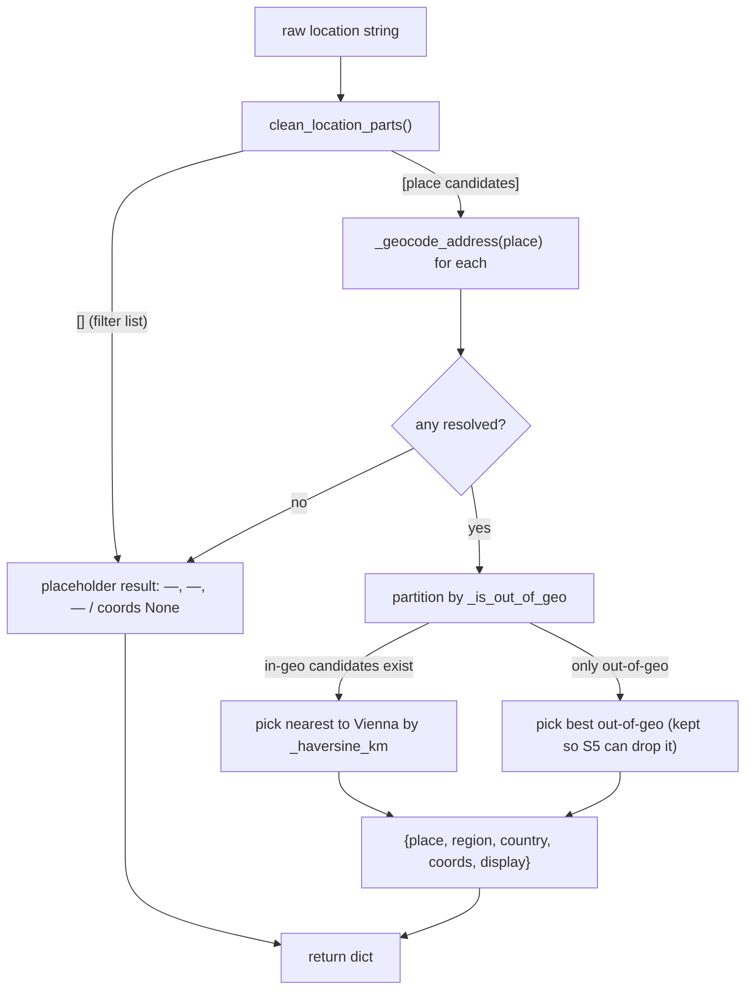

# Specification: `normalize_location()` — geocode resolution, structured fields, nearest-to-Vienna

## Context

Story 3 of PRD [standardized-job-location](../../prds/standardized-job-location/prd.md)
([plan](../../prds/standardized-job-location/plan.md), R1 — geocode-only). The digest
([#121](https://github.com/EnnioTorre/dach-exec-job-alerts/issues/121) role #4,
[#109](https://github.com/EnnioTorre/dach-exec-job-alerts/issues/109)) still shows malformed,
non-uniform locations. This story builds the **composing function** that turns a raw scraped location
string into one standard structured location — the piece that stories 4–6 wire into scrape, rank and
digest.

**This story adds `normalize_location(raw) -> dict` to the shared module `.github/scripts/locations.py`**
(created in S1, resolver added in S2). It composes the already-merged primitives:
`clean_location_parts` (S1) → `_geocode_address` (S2) → `_haversine_km` (S1) → `_is_out_of_geo` (S1),
and assembles `{place, region, country, coords, display}` in German-market local form, with `—`
(`PLACEHOLDER`) for unknown parts. **Nothing imports it yet** — the scrape/rank/digest wiring is
Stories 4–6.

**Resolver extension (confirmed design decision).** To satisfy BAC-7 (two spellings of the same place
produce identical output) and BAC-2 (region-only strings → `—, Region, Country`), the resolver must
return a **canonical place name**, which the merged S2 `_geocode_address` does not. This story
therefore extends the S2 resolver record from `{region, country, coords}` to
`{place, region, country, coords}`, where `place` is the settlement name read from the Nominatim
`address` (`city`/`town`/`village`/`municipality`/`suburb`), German via `accept-language=de`, or
`PLACEHOLDER` when the result has no settlement level (e.g. a region/country query). This is an
in-module extension required by composition — it also updates the two S2 tests that assert the record
shape and the per-place cache load/save (backward-compatible: old cache entries without `place` load
as `PLACEHOLDER`).

Confirmed ground truth (read from `main`, S1+S2 merged):
- `clean_location_parts(raw) -> list[str]` ([locations.py](../../../.github/scripts/locations.py):46)
  — strips UI/junk, splits on commas, drops empties, returns `[]` when > `MAX_LOCATION_PARTS` (5)
  parts (a filter/facet list — digest #121 role #4).
- `_geocode_address(place) -> dict | None` (locations.py:171) — cached/budgeted/≥1 req/s/degrading;
  record is currently `{region, country, coords:(lat,lon)}`. `_geocode_address_query` (142) reads the
  Nominatim `address`; `_to_german_market` (123) maps it to `(region, country)` with the South-Tyrol
  override.
- `_haversine_km(lat1, lon1, lat2, lon2) -> float` (locations.py:71).
- `_is_out_of_geo(country, region=None) -> bool` (locations.py:81) — `False` for AT/DE/CH or region
  `Südtirol`, else `True`.
- `load_location_cache` / `save_location_cache` (locations.py:205, 228) persist
  `{place_key: {region, country, lat, lon} | null}`; this story adds `place` to that record.
- `PLACEHOLDER = "—"` (locations.py:21).
- `conftest.py` puts `.github/scripts` on `sys.path`; `test_locations.py` mocks the resolver/HTTP via
  `monkeypatch` and a `_FakeResp` double (merged in S2).

## Dependencies

- **Blocked by:** `geocode-addressdetails` (Story 2, **merged**) — `normalize_location` calls
  `_geocode_address`; this story also extends that resolver's record with `place`.
- **Blocks:** `scrape-normalize-pass` (Story 4) and `rank-consume-coords-drop-geo` (Story 5) — they
  call `normalize_location` and read its structured fields / `display`; `digest-display-standard-location`
  (Story 6) renders `display`.

Independently deployable: pure addition to a module nothing imports yet; merging it changes no runtime
behaviour.

## Architecture Approach

`normalize_location` always returns a dict with all five keys. Out-of-geography is **not** a separate
flag — it is derivable by the caller via `_is_out_of_geo(result["country"], result["region"])` (Story 5
does the rank-time drop), so the return shape stays `{place, region, country, coords, display}`.

## Files to Modify

| File Path | Change Description | Target Function/Component |
|-----------|-------------------|---------------------------|
| `.github/scripts/locations.py` | Add the Vienna constant, `_to_place(address)`, and `normalize_location(raw)`. Extend `_geocode_address_query` to put `place` in the record, and `load_location_cache`/`save_location_cache` to persist `place` (default `PLACEHOLDER` on load for old entries). | new `normalize_location`, `_to_place`, `_VIENNA`; modify `_geocode_address_query`, `load_location_cache`, `save_location_cache` |
| `.github/tests/test_locations.py` | Add `TestNormalizeLocation` (the 5 plan tests). Update the two S2 tests that assert the resolver record shape to include the new `place` key. | `TestNormalizeLocation`; update `test_addressdetails_resolves_region_country_coords_for_place`, `test_location_cache_round_trip_persists_hits_and_misses` |

No new file is created.

### Behaviour detail — `locations.py` additions/changes

| Symbol | Signature | Behaviour |
|---|---|---|
| `_VIENNA` | `tuple[float, float] = (48.2082, 16.3738)` | Reference point for nearest-place selection (same coords `rank_jobs`/the tests use for Vienna). |
| `_to_place(address)` | `(dict) -> str` | Settlement name from the Nominatim `address`: first non-empty of `city` / `town` / `village` / `municipality` / `suburb`, stripped; else `PLACEHOLDER`. German via `accept-language=de`. **Not** `county`/`state` (those are region). |
| `_geocode_address_query(place)` | `(str) -> dict \| None` | **Changed:** the returned record gains `place` (`_to_place(address)`), so it is `{place, region, country, coords}`. All else unchanged (same request, same degrade-to-`None`). |
| `load_location_cache` / `save_location_cache` | `() -> None` | **Changed:** the persisted record is `{place, region, country, lat, lon} \| null`; `load` reads `place` with default `PLACEHOLDER` (old files without `place` still load). |
| `normalize_location(raw)` | `(str) -> dict` | Compose: (1) `parts = clean_location_parts(raw)`; if empty → placeholder result. (2) For each part, `_geocode_address(part)`; keep non-`None` records. If none → placeholder result. (3) Split resolved into in-geo (`not _is_out_of_geo(region, country→` see note) and out-of-geo. (4) If in-geo non-empty, pick the record with the smallest `_haversine_km(_VIENNA, coords)`; else pick the out-of-geo record with the smallest distance. (5) Build `{place, region, country, coords, display}` from the winner, where `display = f"{place}, {region}, {country}"` (German-market local form; unknown parts already `PLACEHOLDER`). **Never raises.** |

> Note on `_is_out_of_geo` argument order: it is `_is_out_of_geo(country, region=None)`. `normalize_location`
> calls it as `_is_out_of_geo(record["country"], record["region"])`.

**Placeholder result** (empty parts, or nothing resolved): `{"place": PLACEHOLDER, "region": PLACEHOLDER,
"country": PLACEHOLDER, "coords": None, "display": "—, —, —"}` — the BAC-9 degenerate degrade (a
filter/facet list or a fully-unresolvable string). Element-scoped recovery of the real location is
Story 4's scrape-side concern, not this story's.

**Business rules carried from the PRD/plan (make explicit, don't infer):**
- **One standard shape (BAC-1):** `display` is always exactly `place, region, country`, no trailing
  separators, no empty parts, no extra text.
- **Placeholder for unknown parts (BAC-2):** unknown place/region/country show `—` in position, so the
  shape always has three parts (e.g. `—, Steiermark, Österreich`).
- **Nearest-to-Vienna (BAC-5):** when several candidates resolve in-geo, the single location is the one
  closest to Vienna by `_haversine_km`; display and `coords` both come from it.
- **Same place, same output (BAC-7):** two differently-written forms of the same place (`Wien,` /
  `Vienna, Austria`) produce the identical dict — guaranteed by the **canonical `place`** from the
  geocode result plus identical `region`/`country`/`coords`.
- **Out-of-geography (BAC-6):** an out-of-geo winner keeps its real `country`/`region` so the caller
  (Story 5) can drop it via `_is_out_of_geo`. `normalize_location` does **not** drop it itself.
- **German-market local form:** `place`/`region`/`country` are the German exonyms the resolver already
  returns (`Bozen`, `Genf`, `Schweiz`, `Südtirol`); `normalize_location` adds no new mapping.
- **Degrade, never raise (BAC-9):** any `None` from the resolver degrades to placeholder parts.

## Data and Contract Mappings

Resolver record (per candidate, after this story's extension) → `normalize_location` result:

| Resolver record field | Result field | Notes |
|---|---|---|
| `place` (new — `_to_place(address)`) | `place` | canonical settlement; `PLACEHOLDER` when the geocode result has no settlement level |
| `region` | `region` | German-market Bundesland/Kanton/`Südtirol`; `PLACEHOLDER` if absent |
| `country` | `country` | German exonym; `PLACEHOLDER` if absent |
| `coords` (lat, lon) | `coords` | winner's coords; `None` only in the placeholder result |
| — | `display` | `f"{place}, {region}, {country}"` assembled by `normalize_location` |

Nominatim `address` → `place` (new `_to_place` mapping):

| Nominatim `address` key (first non-empty) | → `place` |
|---|---|
| `city` / `town` / `village` / `municipality` / `suburb` | that value (stripped) |
| none of the above present | `PLACEHOLDER` |

## Key Patterns to Follow

| Pattern | Reference Implementation |
|---------|------------------------|
| Compose clean + resolve + distance + geo-predicate | the four merged helpers in `locations.py` (`clean_location_parts`, `_geocode_address`, `_haversine_km`, `_is_out_of_geo`) |
| German-market mapping from a Nominatim `address` | `locations.py:_to_german_market` (123) — `_to_place` mirrors its "first non-empty, else PLACEHOLDER" shape |
| Pure, class-grouped pytest; resolver/HTTP mocked via `monkeypatch` + `_FakeResp` | `test_locations.py` (`TestGeocodeAddressDetails`, the S2 autouse fixture) |

## Existing Code to Reuse

| Existing Asset | Location | How to Reuse | Why Not Create New |
|---------------|----------|--------------|-------------------|
| `clean_location_parts` | `locations.py:46` | Call for step 1 (clean + split + filter-list rejection) | Already the agreed cleaner (S1) |
| `_geocode_address` | `locations.py:171` | Call per candidate for region/country/coords (+ `place` after extension) | The sole resolver (S2); do not re-geocode |
| `_haversine_km` | `locations.py:71` | Nearest-to-Vienna selection | Already the distance primitive |
| `_is_out_of_geo` | `locations.py:81` | Partition in-geo vs out-of-geo candidates | Already the geography predicate (S1) |
| `_to_german_market` / `PLACEHOLDER` | `locations.py:123, 21` | `_to_place` follows its pattern; `PLACEHOLDER` for all unknowns | Established vocabulary |

*`normalize_location` and `_to_place` are genuinely new (no existing function composes the structured
location or extracts the settlement). Everything they build on already exists in `locations.py`.*

## Verification Criteria

The five plan tests (Level `CT`, Type `Functional`), all pure — the resolver is mocked via
`monkeypatch.setattr(locations, "_geocode_address", …)` (unit-level, no HTTP, no cache). `test_locations.py`
is extended with `TestNormalizeLocation`; the two S2 record-shape tests are updated for the new `place`
key (not new test names — a shape change the extension requires).

### Component Tests (CT)

| Test Name | ITPF Test Type | What it verifies | Risk mitigated | BAC |
|-----------|----------------|------------------|----------------|-----|
| `test_normalize_builds_place_region_country_display` | Functional | `"Wels,"` (resolver mocked → place `Wels`, region `Oberösterreich`, country `Österreich`) ⇒ `display == "Wels, Oberösterreich, Österreich"` + the structured fields | Non-uniform location shapes in the digest | BAC-1 |
| `test_normalize_uses_placeholder_for_unknown_parts` | Functional | A region-only resolve (place `—`, region `Steiermark`/`—`) ⇒ `display == "—, Steiermark, Österreich"` (or `"—, —, Österreich"`) — always three parts | Shape collapses to fewer than three parts | BAC-2 |
| `test_normalize_multi_place_picks_closest_to_vienna` | Functional | `"Thalheim bei Wels, Wien"` (both mocked with coords) ⇒ winner is Wien (nearest Vienna); `coords` + `display` are Wien's | Multi-location posting scored on the wrong place | BAC-5 |
| `test_normalize_two_spellings_same_place_identical_output` | Functional | `"Wien,"` and `"Vienna, Austria"` (resolver mocked to the same canonical Vienna record) ⇒ identical result dict | Same place renders/scored inconsistently | BAC-7 |
| `test_normalize_out_of_geo_place_flagged` | Functional | `"San Francisco, CA"` (resolver mocked → country `USA`) ⇒ result carries `country=="USA"` and `_is_out_of_geo(result["country"], result["region"]) is True` | Out-of-geography row not marked for the rank-time drop | BAC-6 |

### System / Integration Tests (ST · SIT)
None — pure composition; wiring is Stories 4–6.

### Acceptance Verification (UAT)
None at this level.

**Manual check (optional):** with `RANK_GEOCODE=true`, `python3 -c "import sys; sys.path.insert(0,'.github/scripts'); import locations; print(locations.normalize_location('Wels,'))"` (live Nominatim) prints a `Wels, Oberösterreich, Österreich` record.

## Blast Radius

- **Files directly modified:** `.github/scripts/locations.py`, `.github/tests/test_locations.py` (2 files).
- **Dependent systems affected:** none yet — `normalize_location` is unused until Story 4. The resolver
  extension (`place`) is backward-compatible: the cache tolerates old entries, and no current caller
  reads the resolver record (it is only reached via `normalize_location`, which this PR adds).
- **Regression risk:** low — additive composition. The one behavioural change to merged code is the
  resolver record gaining `place`; the two S2 tests asserting the record shape are updated in lockstep,
  and the persisted cache stays readable. CI `pytest` + `quality` (ruff advisory, gitleaks) run on the
  changes. Small-PR rule: 2 code files, keep the diff ≤200 lines (compose + `_to_place` + 5 tests +
  2 updated assertions are within budget).

## Security Surface

`normalize_location` adds **no new outbound call** — it reaches the network only through the merged,
already-guarded `_geocode_address` (fixed URL, timeout, budget, ≥1 req/s, degrades to `None`). The
resolver extension reads additional `address` string fields (`city`/`town`/…) from the same distrusted
response; they are only `.strip()`-ed into the `place` string, never used to build a URL or path.

| What it must do | Verified by |
|---|---|
| Degrade to the placeholder result (never raise) when the resolver returns `None` | `test_normalize_uses_placeholder_for_unknown_parts` (and the composition's `clean`→empty path) |

## Test Data Requirements

- **Fixtures:** none on disk — tests `monkeypatch` `locations._geocode_address` to return canned
  records (or a dict keyed by place), and pass inline raw strings to `normalize_location`.
- **Edge-case data:**
  - `"Wels,"` → `{place:"Wels", region:"Oberösterreich", country:"Österreich", coords:(48.16,14.03)}`.
  - Region-only → `{place:"—", region:"Steiermark", country:"Österreich", coords:(…)}`.
  - `"Thalheim bei Wels, Wien"` → two records with distinct coords (Wien nearest Vienna).
  - `"Wien,"` and `"Vienna, Austria"` → both map to the identical canonical Vienna record.
  - `"San Francisco, CA"` → `{place:"San Francisco", region:"California", country:"USA", coords:(…)}`.

## Out of Scope

- Wiring `normalize_location` into scrape (`scrape_jobs.py`, post-scrape pass) — Story 4, incl.
  **element-scoped extraction** that recovers the real location from a filter/facet row (digest #121
  role #4) rather than blanking it to `—, —, —`.
- Rank-time consumption of `coords` and the out-of-geography **drop** — Story 5.
- Rendering `display` in the digest — Story 6.
- Any change to `rank_jobs`'s geocoding, `_DACH_LOCATION_POINTS`, or the `_is_out_of_geo`/`_haversine_km`
  bodies — reused as-is.
