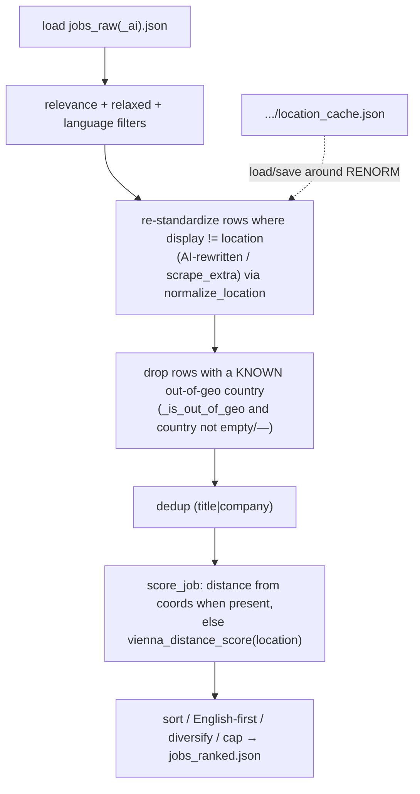

# Specification: Rank consumes structured coords, re-normalizes after AI, drops out-of-geography

## Context

Story 5 of PRD [standardized-job-location](../../prds/standardized-job-location/prd.md)
([plan](../../prds/standardized-job-location/plan.md), R1). This is the **authoritative** location pass:
`rank_jobs.py` re-standardizes any location the optional AI stage rewrote (BAC-8), scores distance from
the precomputed `coords` (BAC-5/7), and drops out-of-geography postings from the shortlist (BAC-6) — while
leaving already-resolved rows' scores unchanged (BAC-9).

It closes the pipeline interactions the gap-critic flagged on PR #125 (the Story-4 post-scrape pass is
not authoritative): the daily order is **scrape → AI pre-rank → rank → scrape_extra → rank-again**, so
`ai_pre_rank_enrich.py` can overwrite `location` and `scrape_extra.py` appends un-normalized rows — both
are standardized here, at rank time.

Confirmed ground truth (read from `main`):
- `rank_jobs.main()` (L725): reads `/tmp/jobs/jobs_raw_ai.json` if it exists else `/tmp/jobs/jobs_raw.json`
  (L726), `_load_geocode_cache()`, then `relevant = [is_relevant]` → relaxed fallback → optional
  `RANK_LANGUAGE_ONLY` gate → dedup (`fingerprint` = title|company) → `score_job` → sort → English-first
  → source-diversify → cap → writes `/tmp/jobs/jobs_ranked.json`.
- `score_job(job)` (L701): `0.35·vienna_distance_score(job["location"]) + 0.35·language_score + 0.30·it_management_focus_score`.
- `vienna_distance_score(location)` (L626): buckets `_distance_from_vienna_km(location)` (None → 2.4;
  ≤25→5.0; ≤100→4.7; ≤250→4.2; ≤450→3.5; ≤700→2.8; ≤900→2.2; else 1.8).
- `_distance_from_vienna_km(location)` (L597): token-match against `_DACH_LOCATION_POINTS`; else
  `_geocode(location)` when not `_is_bare_country_location`; else country-constant fallback. `_geocode`
  (L523) is the cached/budgeted/≥1 req/s Nominatim wrapper; `_DACH_LOCATION_POINTS["vienna"]` is the
  Vienna reference.
- **Story 4 attached** (merged, in `jobs_raw.json` rows): `location` = the standard `display`, plus
  `place`, `region`, `country`, `coords` ((lat,lon) or `None`), and `display`. First-pass rows have
  `display == location`.
- `locations.normalize_location(raw) -> {place, region, country, coords, display}`,
  `locations._is_out_of_geo(country, region=None)`, `locations.load_location_cache`/`save_location_cache`
  (all merged). `_is_out_of_geo` returns `True` for empty/`PLACEHOLDER` country too — so the drop must
  guard against unknown vs genuinely-foreign (see below).
- `test_rank_jobs.py` mocks Nominatim via `monkeypatch` + `_FakeResp`; the autouse fixture
  (`_geocoding_off_by_default`, L20) sets `RANK_GEOCODE=false`, empties the cache path, and resets the
  geocode budget/timestamp.

## Dependencies

- **Blocked by:** `scrape-normalize-pass` (Story 4, **merged**) — reads the `coords`/`country`/`region`/
  `display` fields; `normalize-location-core` (Story 3) — imports `normalize_location`;
  `locations-gazetteer-cleaner` (Story 1) — `_is_out_of_geo`.
- **Blocks:** `digest-display-standard-location` (Story 6) — renders the standardized rows this stage
  finalises.

Independently deployable: the coords path falls back to today's `vienna_distance_score(location)` when a
row lacks `coords`, and re-normalization only touches rows the AI/second-pass changed — so rows that were
already resolved keep their exact previous score.

## Architecture Approach

## Files to Modify

| File Path | Change Description | Target Function/Component |
|-----------|-------------------|---------------------------|
| `.github/scripts/rank_jobs.py` | Add `from locations import PLACEHOLDER, _is_out_of_geo, load_location_cache, normalize_location, save_location_cache`. Add `_renormalize_rows(jobs)` and `_row_out_of_geo(job)`. Refactor the distance buckets into `_distance_to_score(d)` and add coords-first `_location_distance_score(job)` (tolerates malformed coords); `score_job` uses it. Guard `_distance_from_vienna_km` to return `None` for the all-placeholder location (no geocode). Wire `load_location_cache()` → `_renormalize_rows(jobs)` → `save_location_cache()` → out-of-geo drop into `main()` **right after loading, before the relevance/relaxed-fallback filters**. | new `_renormalize_rows`, `_row_out_of_geo`, `_distance_to_score`, `_location_distance_score`; modify `score_job`, `_distance_from_vienna_km`, `main()` |
| `.github/tests/test_rank_jobs.py` | Add `TestStandardizedLocationRanking` with the 5 plan tests + a coords-fallback test. | `TestStandardizedLocationRanking` |

No new file is created.

### Behaviour detail — `rank_jobs.py` additions/changes

| Symbol | Signature | Behaviour |
|---|---|---|
| `_renormalize_rows(jobs)` | `(list[dict]) -> None` | In place, for each row **where `j.get("display") != j.get("location")`** (AI-rewritten, or `scrape_extra` rows with no `display`): `norm = normalize_location(j.get("location", ""))`; set `location = norm["display"]`, `place/region/country/coords/display`. Rows already normalized by scrape (`display == location`) are left untouched — preserving their `coords` and therefore their score (BAC-9). Never raises. |
| `_row_out_of_geo(job)` | `(dict) -> bool` | `True` only when the country is **known and foreign**: `c = (job.get("country") or "").strip()`; `c and c != PLACEHOLDER and _is_out_of_geo(c, job.get("region"))`. An empty/`—` country (unresolved) is **not** dropped — it is kept with the placeholder (BAC-9), not treated as out-of-geo. |
| `_distance_to_score(d)` | `(float \| None) -> float` | The existing bucket ladder extracted verbatim (None → 2.4; ≤25→5.0; …; else 1.8). |
| `_location_distance_score(job)` | `(dict) -> float` | `coords = job.get("coords")`; if it is a 2-length list/tuple of numbers: `_distance_to_score(_haversine_km(*_DACH_LOCATION_POINTS["vienna"], float(coords[0]), float(coords[1])))`; **any malformed/short/non-numeric `coords` degrades to** `_distance_to_score(_distance_from_vienna_km(job.get("location", "")))`. Never raises — a bad `coords` from (AI-influenceable) `jobs_raw_ai.json` must not abort the rank. Two spellings carry identical `coords` ⇒ identical score (BAC-7). |
| `score_job(job)` | `(dict) -> float` | Unchanged formula; the distance term is now `_location_distance_score(job)` instead of `vienna_distance_score(job["location"])`. |
| `_distance_from_vienna_km(location)` | `(str) -> float \| None` | **Guard added:** if the location has no alphanumeric character (the all-placeholder `—, —, —`), return `None` immediately — never geocode it. Everything else unchanged. |
| `main()` wiring | — | **Right after loading `jobs` (before the relevance/relaxed-fallback/`RANK_LANGUAGE_ONLY` filters), operating on the full `jobs` list:** `load_location_cache()`; `_renormalize_rows(jobs)`; `save_location_cache()`; `jobs = [j for j in jobs if not _row_out_of_geo(j)]` (with a count print). Running the drop **before** the relaxed fallback means the shortlist tops up to `target_rank_count` from a geo-clean pool — not short after a late drop. |

**Business rules carried from the PRD/plan (make explicit, don't infer):**
- **Nearest-to-Vienna from coords (BAC-5):** the distance term uses the row's precomputed `coords` when
  present; the nearest-place choice was already made by `normalize_location` upstream.
- **Out-of-geography dropped (BAC-6):** a row whose **known** standardized country is not AT/DE/CH (and
  not South-Tyrol region) is removed from the shortlist (e.g. digest #121 role #9 "United Kingdom"). A
  row with an **unknown** location (`—`, e.g. role #4) is **kept** with the placeholder — unknown ≠
  foreign.
- **Same place, same score (BAC-7):** identical `coords` ⇒ identical distance sub-score, regardless of
  the source spelling.
- **Standard holds after AI (BAC-8):** re-normalization re-standardizes any row the AI stage rewrote
  (detected by `display != location`), so BAC-1/2 and the geography rule hold on the AI path too.
- **No regression (BAC-9):** rows already normalized by scrape (`display == location`) are not
  re-normalized and not re-geocoded, so their `coords` and score are unchanged; the coords path falls
  back to today's `vienna_distance_score` when a row has no `coords`.
- **Out-of-geo rows remain in source stats:** the per-source scraped/unique counts are computed in
  `scrape_jobs` (before this stage) and carried in `jobs_raw.json`; dropping rows here affects only the
  ranked shortlist, not those stats.

## Data and Contract Mappings

Row field (from Story 4) → rank consumption:

| Row field | Used by | Notes |
|---|---|---|
| `coords` `(lat,lon)` / `None` | `_location_distance_score` | distance term when present; else fall back to `location` |
| `country`, `region` | `_row_out_of_geo` | drop when country known & `_is_out_of_geo`; keep when `—`/empty |
| `location` / `display` | `_renormalize_rows` | re-normalize when `display != location`; else leave |

## Key Patterns to Follow

| Pattern | Reference Implementation |
|---------|------------------------|
| Cached location pass wrapped in `load`/`save_location_cache` | `scrape_jobs.py:_normalize_locations` + its `main()` wiring (Story 4) |
| Distance bucketing & Vienna reference | `rank_jobs.py:vienna_distance_score` / `_distance_from_vienna_km` / `_DACH_LOCATION_POINTS["vienna"]` |
| Pure, class-grouped pytest; Nominatim mocked via `monkeypatch` + `_FakeResp`; autouse geocode reset | `test_rank_jobs.py` (`TestGeocoding`, `_geocoding_off_by_default`) |

## Existing Code to Reuse

| Existing Asset | Location | How to Reuse | Why Not Create New |
|---------------|----------|--------------|-------------------|
| `normalize_location` | `locations.py` | Call in `_renormalize_rows` | The whole normalizer exists (Story 3) |
| `_is_out_of_geo` | `locations.py` | Core of `_row_out_of_geo` | The geography predicate (Story 1) |
| `load_location_cache` / `save_location_cache` | `locations.py` | Wrap the re-normalize pass so repeated places are free | Same cache scrape warms (Story 2/4) |
| `_haversine_km`, `_DACH_LOCATION_POINTS["vienna"]` | `rank_jobs.py` | Distance from `coords` | Already the distance primitive + Vienna point |
| `vienna_distance_score` buckets | `rank_jobs.py:626` | Extract into `_distance_to_score`; both the coords and location paths reuse it | Don't duplicate the ladder |

*`_renormalize_rows`, `_row_out_of_geo`, `_location_distance_score`, `_distance_to_score` are new, but each
is a thin composition of merged helpers; no existing function covers rank's coords-first scoring or the
out-of-geo drop.*

## Verification Criteria

The five plan tests plus a sixth added in review (the coords-absent / malformed-coords fallback), Level
`CT`, Type `Functional`, pure — `normalize_location`/geocoding mocked via `monkeypatch`; the autouse
geocode-reset fixture keeps them hermetic. Follows `test_rank_jobs.py`.

### Component Tests (CT)

| Test Name | ITPF Test Type | What it verifies | Risk mitigated | BAC |
|-----------|----------------|------------------|----------------|-----|
| `test_rank_uses_row_coords_for_distance_when_present` | Functional | A job with `coords` at Vienna ⇒ distance sub-score 5.0 (the coords path, not the `location` string) | Ranking re-derives the wrong place | BAC-5 |
| `test_rank_drops_out_of_geography_rows_from_shortlist` | Functional | A `country:"USA"` row is dropped by `_row_out_of_geo`; a DACH row and a `country:"—"` placeholder row are kept | Irrelevant foreign postings reach the reader | BAC-6 |
| `test_rank_two_spellings_same_place_same_score` | Functional | Two jobs with identical `coords` but `location` strings that would score **differently** via the string path (`"Wien"` → 5.0, `"Unresolvable Place XYZ"` → 2.4) ⇒ identical score ⇒ coords (not the string) drive it | Inconsistent ranking for the same place | BAC-7 |
| `test_rank_renormalizes_ai_rewritten_location` | Functional | A row with `display != location` (AI-rewritten) ⇒ `_renormalize_rows` (normalize mocked) rewrites its fields; a `display == location` row is left untouched | AI stage reintroduces non-standard shapes | BAC-8 |
| `test_rank_preserves_existing_resolved_place_scores` | Functional | A scrape-normalized row (`display == location`, has `coords`) keeps its `coords` and `score_job` value after the pass | Ranking regression on working rows | BAC-9 |
| `test_rank_falls_back_to_location_when_no_coords` | Functional | No `coords`, and a malformed `coords` (`"bad"`, `[1.0]`), both degrade to the location-string path (never crash) | A missing/malformed coords aborts the whole rank | BAC-9 |

### System / Integration Tests (ST · SIT)
None — unit-level; the full `scrape → rank → test_scraper_loop` threshold check is the existing validation
stage (the drop reduces the shortlist but out-of-geo rows were never in the DACH-relevant pool).

### Acceptance Verification (UAT)
None at this level.

**Manual check (optional):** `python3 -c "import sys; sys.path.insert(0,'.github/scripts'); import rank_jobs; print(rank_jobs._location_distance_score({'coords': (48.2082,16.3738)}))"` prints `5.0`.

## Blast Radius

- **Files directly modified:** `.github/scripts/rank_jobs.py`, `.github/tests/test_rank_jobs.py` (2 files).
- **Dependent systems affected:** `jobs_ranked.json` now excludes known out-of-geo rows and its scores
  use `coords`. **Downstream:** `create_issue.py` renders the ranked rows (fewer, standardized) — Story 6
  switches to the `display` field. No change to `scrape_jobs.py`.
- **Regression risk:** medium. The score term changes source (coords vs string) — guarded by the
  `display == location` skip so already-resolved rows keep their exact score (pinned by
  `test_rank_preserves_existing_resolved_place_scores`), and by the coords→location fallback. The drop
  removes rows from the shortlist: it is guarded to **known** foreign countries only, so unresolved
  placeholder rows are retained (BAC-9). `TEST_MIN_*`: out-of-geo rows were not DACH-relevant, but the
  validation loop confirms the ranked count still meets thresholds. CI `pytest` + `quality` run on the
  changes.

## Security Surface

- **New attack surface:** none inbound. Outbound geocoding is the merged, guarded `_geocode_address`
  (via `normalize_location`) and the existing `_geocode` — fixed URL, timeout, budget, ≥1 req/s, degrade
  to `None`. The placeholder guard prevents a wasted geocode of `—, —, —`.
- **Input validation:** untrusted scraped/AI location strings flow through `normalize_location`
  (never raises); `_renormalize_rows` tolerates missing/`None` fields; `_row_out_of_geo` coerces
  `None`/missing country to a kept row.
- **Data sensitivity:** only public place strings; no PII/credentials.

| What it must do | Verified by |
|---|---|
| Keep an unknown-location row (`country` empty/`—`), drop only a known foreign one | `test_rank_drops_out_of_geography_rows_from_shortlist` |
| Not re-geocode / not alter an already-resolved row's score | `test_rank_preserves_existing_resolved_place_scores` |
| Degrade to the string path (never crash the rank) on a malformed `coords` from `jobs_raw_ai.json` | `test_rank_falls_back_to_location_when_no_coords` |

## Test Data Requirements

- **Fixtures:** none on disk — tests build inline job dicts and `monkeypatch` `rank_jobs.normalize_location`
  (for the re-normalize test) and the autouse geocode-off fixture.
- **Edge-case data:**
  - `{"coords": (48.2082, 16.3738), "location": "Wien, Wien, Österreich", "display": "Wien, Wien, Österreich"}` → score 5.0.
  - `{"country": "USA", "region": "California", ...}` (drop) vs `{"country": "Österreich", ...}` (keep) vs `{"country": "—", "location": "—, —, —"}` (keep).
  - Two rows, same `coords`, different `location` strings → equal distance score.
  - `{"location": "München, Bayern, Deutschland", "display": "Munich"}` (AI-rewritten: display != location) vs `{"location": "Graz, Steiermark, Österreich", "display": "Graz, Steiermark, Österreich"}` (untouched).

## Out of Scope

- Switching the digest renderer to the `display` field — Story 6.
- Any change to `scrape_jobs.py` (the post-scrape pass) or `create_issue.py`, or to
  `locations.py`/`normalize_location` internals — reused as-is.
- Element-scoped extraction / recovering role #4's real location — a later story (PRD open-decision #9).
- Changing the ranking weights or the distance→score buckets — only the distance term's **source**
  (coords) changes, not the ladder.
