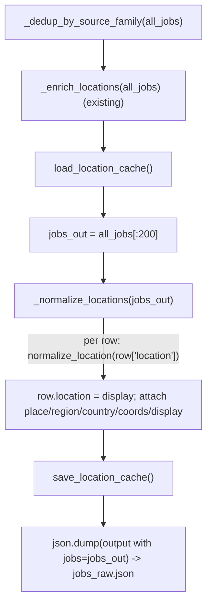

# Specification: Apply normalization post-scrape (clean `jobs_raw.json`)

## Context

Story 4 of PRD [standardized-job-location](../../prds/standardized-job-location/prd.md)
([plan](../../prds/standardized-job-location/plan.md), R1 — geocode-only). This is the **wiring story
that makes the feature visible** in the live digest: it runs `normalize_location` (merged in Story 3,
`locations.py`) over the scraped rows just before `jobs_raw.json` is written, so every downstream stage
(rank, AI, digest) receives one standardized, structured location instead of the malformed strings in
digest [#121](https://github.com/EnnioTorre/dach-exec-job-alerts/issues/121) /
[#109](https://github.com/EnnioTorre/dach-exec-job-alerts/issues/109).

**Concretely:** in `scrape_jobs.py` `main()`, after the existing `_enrich_locations(all_jobs)`
(L2398) and before `jobs_raw.json` is written (L2430), a new `_normalize_locations(jobs)` pass rewrites
each row's `location` to the normalized `display` and attaches the structured fields. The location cache
is loaded before the pass and saved after (and persisted across daily runs via the workflow's
`actions/cache`), so repeated places cost no new Nominatim request and the per-run geocode budget warms
over time.

**Scope decisions (confirmed with the stakeholder):**
- **String-level only.** The cleaner's filter/facet-list rejection (`clean_location_parts → []` for
  `> MAX_LOCATION_PARTS` parts) turns digest #121 **role #4** (the "all Austrian states" karriere.at
  filter list) into the placeholder `—, —, —` — the junk no longer appears (BAC-4). **Recovering** that
  posting's *real* location by fixing the parser's element selection (element-scoped extraction) is a
  **later story**, out of scope here (PRD open-decision #9 is resolved this way for v1).
- **Cache wiring included.** `load_location_cache()`/`save_location_cache()` are wired into `main()`, and
  `/tmp/jobs/location_cache.json` is added to the workflow's existing geocode `actions/cache` step, so
  the geocode budget warms across runs rather than cold-starting each day.

Confirmed ground truth (read from `main`):
- `scrape_jobs.main()` (L2237): `_dedup_by_source_family(all_jobs)` → `_enrich_locations(all_jobs)`
  (L2398) → builds `output = {..., "jobs": all_jobs[:200]}` → `json.dump` to `/tmp/jobs/jobs_raw.json`
  (L2430–2432). `deduped_source_stats`/`family_stats` are computed from `all_jobs` **before** the pass
  and key off `source_name`, so location normalization does not affect them.
- `_enrich_locations(jobs)` (L1875) is the existing in-place, bounded, env-gated location pass — the
  structural pattern `_normalize_locations` mirrors (in-place over the job list, never raises).
- `locations.normalize_location(raw) -> {place, region, country, coords, display}` (merged, Story 3) —
  cleans/splits, geocodes each candidate, picks the in-geo place nearest Vienna, degrades to
  `{—, —, —, coords None, display "—, —, —"}`; **never raises**.
- `locations.load_location_cache()` / `save_location_cache()` (merged, Story 2) — persist the per-place
  cache at `LOCATION_CACHE_PATH` (default `/tmp/jobs/location_cache.json`); currently **inert** (no
  caller) — this story is their first wiring.
- The workflow caches the geocode cache: `.github/workflows/dach-exec-job-alerts.yml` L39–45,
  `actions/cache@v4`, `path: /tmp/jobs/geocode_cache.json`, `key: geocode-cache-${{ github.run_id }}`,
  `restore-keys: geocode-cache-`.
- `scrape_jobs.py` does **not** import `locations` yet; `conftest.py` puts `.github/scripts` on
  `sys.path`, and a script run adds its own dir, so `from locations import …` resolves both in tests and
  at runtime. A scraped row is a `dict` with `location` (str) plus `title`/`company`/`application_url`/
  `source_url`/`source_name`/`lang` etc.

## Dependencies

- **Blocked by:** `normalize-location-core` (Story 3, **merged**) — provides `normalize_location`;
  `geocode-addressdetails` (Story 2) — provides the cache load/save.
- **Blocks:** `rank-consume-coords-drop-geo` (Story 5) reads the structured `coords`/`country`/`region`
  this pass attaches; `digest-display-standard-location` (Story 6) renders the `display` field.

Independently deployable: the richer `location` + new fields are additive — current readers
(`rank_jobs` reads `location`, `create_issue` renders `location`) keep working and simply see a cleaner
string; new fields are ignored until Stories 5–6 consume them.

## Architecture Approach

`_normalize_locations` runs over the **written slice** (`all_jobs[:200]`) — the rows beyond the cap are
dropped, so normalizing them would waste the geocode budget. The per-run budget
(`LOCATION_GEOCODE_MAX`) bounds actual Nominatim calls; rows past the budget degrade to the placeholder
and are filled on later runs as the cache (persisted + restored via `actions/cache`) warms.

## Files to Modify

| File Path | Change Description | Target Function/Component |
|-----------|-------------------|---------------------------|
| `.github/scripts/scrape_jobs.py` | Add `from locations import normalize_location, load_location_cache, save_location_cache`. Add `_normalize_locations(jobs)` (in-place). In `main()`, after `_enrich_locations(all_jobs)`: `load_location_cache()`, `jobs_out = all_jobs[:200]`, `_normalize_locations(jobs_out)`, `save_location_cache()`, and use `jobs_out` in `output["jobs"]`. | new `_normalize_locations`; `main()` |
| `.github/tests/test_scrape_jobs.py` | Add `TestNormalizeLocations` with the 4 plan tests. | `TestNormalizeLocations` |
| `.github/workflows/dach-exec-job-alerts.yml` | Add `/tmp/jobs/location_cache.json` to the existing `actions/cache` `path:` (multi-line), and widen the step name/comment to cover both caches. | "Restore geocode cache" step (L39–45) |

No new file is created.

### Behaviour detail — `scrape_jobs.py` additions

| Symbol | Signature | Behaviour |
|---|---|---|
| `_normalize_locations(jobs)` | `(list[dict]) -> None` | In place, for each row: `norm = normalize_location(j.get("location", ""))`; then `j["location"] = norm["display"]`, `j["place"] = norm["place"]`, `j["region"] = norm["region"]`, `j["country"] = norm["country"]`, `j["coords"] = norm["coords"]`, `j["display"] = norm["display"]`. **Never raises** — `normalize_location` never raises, and `j.get("location", "")` tolerates a missing/`None` location. Mirrors `_enrich_locations`'s in-place, non-raising shape. |
| `main()` wiring | — | After `_enrich_locations(all_jobs)`: `load_location_cache()`; `jobs_out = all_jobs[:200]`; `_normalize_locations(jobs_out)`; `save_location_cache()`; then `output["jobs"] = jobs_out` (same rows, now normalized). Stats computed earlier from `all_jobs` are unchanged. |

**Business rules carried from the PRD/plan (make explicit, don't infer):**
- **One standard shape (BAC-1):** after the pass, `location` is the `display` string
  (`place, region, country`, German-market form) — no trailing commas, empty parts, or extra text.
- **Structured fields (BAC-3):** every normalized row carries `place`, `region`, `country`, `coords`
  (plus `display`) so rank (S5) and digest (S6) can consume them without re-parsing.
- **Filter/UI text rejected (BAC-4):** a filter/facet list (`> MAX_LOCATION_PARTS` places, e.g. digest
  #121 role #4) or UI junk is rejected by `clean_location_parts` → the row's `location` becomes the
  placeholder `—, —, —`; the junk text never reaches ranking or the digest.
- **Never raises (BAC-4):** a pathological or missing `location` degrades to the placeholder; one bad
  row must never abort the scrape (the `parsers never raise` convention).
- **Budget / degradation (carried, BAC-9 spirit):** the pass normalizes the **written** rows only; the
  `LOCATION_GEOCODE_MAX` budget bounds Nominatim calls, over-budget rows degrade to placeholder, and the
  persisted + `actions/cache`-restored `location_cache.json` warms the mapping across runs.
- **No stat regression:** `deduped_source_stats`/`family_stats` are computed before the pass and key off
  `source_name`, so scrape `TEST_MIN_*` thresholds and the source-performance table are unaffected.

## Data and Contract Mappings

`normalize_location(row["location"])` result → scraped row (in place):

| `normalize_location` field | Row field written | Notes |
|---|---|---|
| `display` | `location` (overwrites raw) **and** `display` | cleaned `place, region, country`; `location` is kept as the display string so current readers (`rank_jobs`, `create_issue`) immediately show clean text; the explicit `display` field is what Story 6 switches the renderer to |
| `place` | `place` | settlement or `—` |
| `region` | `region` | Bundesland/Kanton/`Südtirol` or `—` |
| `country` | `country` | German exonym or `—`; Story 5 drops out-of-geo via `_is_out_of_geo(country, region)` |
| `coords` | `coords` | `(lat, lon)` or `None`; Story 5 scores distance from these |

## Key Patterns to Follow

| Pattern | Reference Implementation |
|---------|------------------------|
| In-place, bounded, non-raising location pass over the job list, wired into `main()` | `scrape_jobs.py:_enrich_locations` (1875) + its call site (2398) |
| Persisted cache load/save around a geocoding pass, warmed across runs via `actions/cache` | `rank_jobs.py` `_load_geocode_cache`/`_save_geocode_cache` + `.github/workflows/dach-exec-job-alerts.yml` L39–45 (geocode cache) |
| Class-grouped pytest, `import scrape_jobs`, `monkeypatch` for network-touching deps | `.github/tests/test_scrape_jobs.py` (e.g. `TestInferLanguageHint`, which monkeypatches enrichment) |

## Existing Code to Reuse

| Existing Asset | Location | How to Reuse | Why Not Create New |
|---------------|----------|--------------|-------------------|
| `normalize_location` | `locations.py` (Story 3) | Call per row; it does all cleaning/geocoding/standardizing | The whole normalization logic already exists — this story only wires it |
| `load_location_cache` / `save_location_cache` | `locations.py` (Story 2) | Call around the pass in `main()`; add the file to the workflow cache | The cache is built and tested; this is its first wiring |
| `_enrich_locations` + its call site | `scrape_jobs.py:1875, 2398` | Pattern for the in-place pass and where to wire it | Same shape (in-place, env-gated, non-raising) — follow it |
| geocode `actions/cache` step | workflow L39–45 | Extend its `path:` to also cache `location_cache.json` | A second cache entry is redundant; one step caches both |

*`_normalize_locations` is genuinely new (nothing wires `normalize_location` into scrape yet), but it is
a thin in-place pass built entirely on merged code.*

## Verification Criteria

The four plan tests (Level `CT`, Type `Functional`). The two "good location" tests mock
`scrape_jobs.normalize_location` (so no network, controlled output); the filter-list and never-raises
tests use the **real** `normalize_location` on no-geocode paths (`clean_location_parts → []` → placeholder,
with `RANK_GEOCODE=false` set defensively), so they genuinely exercise rejection/degradation. Tests
follow `test_scrape_jobs.py` conventions (`import scrape_jobs`, class-grouped, `monkeypatch`).

### Component Tests (CT)

| Test Name | ITPF Test Type | What it verifies | Risk mitigated | BAC |
|-----------|----------------|------------------|----------------|-----|
| `test_scrape_normalizes_messy_location_to_display_and_fields` | Functional | A row `{"location": "Wels,"}` (normalize mocked → `display "Wels, Oberösterreich, Österreich"`) ⇒ after `_normalize_locations`, `row["location"] == "Wels, Oberösterreich, Österreich"` | A messy row becomes standard `display` in `jobs_raw.json` | BAC-1 |
| `test_scrape_normalization_attaches_structured_fields` | Functional | Same pass ⇒ the row gains `place`, `region`, `country`, `coords` (and `display`) | Rank/digest can't consume structured location | BAC-3 |
| `test_scrape_normalization_rejects_filter_list_text` | Functional | A row whose `location` is the digest-#121 "all Austrian states" string (real `normalize_location`, `RANK_GEOCODE=false`) ⇒ `row["location"] == "—, —, —"`, the filter text gone | A filter/facet list is shown as a posting's location (digest #109/#121) | BAC-4 |
| `test_scrape_normalization_never_raises_on_bad_location` | Functional | A pathological row (`location` missing / `None`) passed to `_normalize_locations` ⇒ no exception, row degrades to the placeholder | One bad row aborts the whole scrape | BAC-4 |

### System / Integration Tests (ST · SIT)
None — unit-level pass; the full `scrape → rank → test_scraper_loop` threshold check is exercised by the
existing validation loop, not added here.

### Acceptance Verification (UAT)
None at this level.

**Manual check (optional):** after a local scrape, `jq '.jobs[0] | {location, place, region, country, coords, display}' /tmp/jobs/jobs_raw.json` shows the standardized fields.

## Blast Radius

- **Files directly modified:** `.github/scripts/scrape_jobs.py`, `.github/tests/test_scrape_jobs.py`,
  `.github/workflows/dach-exec-job-alerts.yml` (3 files).
- **Dependent systems affected:** `jobs_raw.json` row shape gains `place`/`region`/`country`/`coords`/
  `display` and `location` becomes the cleaned display string. **Downstream readers on `main`:**
  `rank_jobs.py` reads `location` (now a cleaner string — still geocodes it as before, no regression;
  S5 will switch to `coords`); `create_issue.py` renders `location` (now shows the clean display
  immediately; S6 switches to the `display` field). `_enrich_locations` runs **before** the pass, so its
  recovery is preserved.
- **Regression risk:** low–medium. The behavioural change is real (it rewrites `location`), but it is
  additive and backward-compatible: readers that geocoded/rendered `location` still work on the cleaner
  string. The geocode budget means a cold run normalizes ~`LOCATION_GEOCODE_MAX` rows and placeholders
  the rest until the cache warms — acceptable degradation (BAC-9), mitigated by the `actions/cache`
  restore. CI `pytest` + `quality` run on the changes; the validation loop confirms `TEST_MIN_*` still
  holds (stats are pre-pass). Small-PR: 3 files, small diffs.

## Security Surface

- **New attack surface:** none inbound. Outbound geocoding is the merged, guarded `_geocode_address`
  (via `normalize_location`) — fixed URL, timeout, budget, ≥1 req/s, degrades to `None`. The pass adds
  no new outbound call type.
- **Input validation:** every row's untrusted scraped `location` flows through `normalize_location`,
  which never raises; `_normalize_locations` additionally tolerates a missing/`None` `location`.
- **Data sensitivity:** only public place strings; no PII/credentials. The cache file is written to the
  operator-controlled `LOCATION_CACHE_PATH`.

| What it must do | Verified by |
|---|---|
| Never raise on a pathological / missing `location` (one bad row must not abort the scrape) | `test_scrape_normalization_never_raises_on_bad_location` |
| Reject filter/UI text so it never reaches ranking/digest | `test_scrape_normalization_rejects_filter_list_text` |

## Test Data Requirements

- **Fixtures:** none on disk — tests build inline row dicts and either `monkeypatch`
  `scrape_jobs.normalize_location` (good-location cases) or set `RANK_GEOCODE=false` and use the real one
  (filter-list / never-raises cases).
- **Edge-case data:**
  - `{"location": "Wels,"}` with mocked `normalize_location → {place:"Wels", region:"Oberösterreich", country:"Österreich", coords:(48.16,14.03), display:"Wels, Oberösterreich, Österreich"}`.
  - `{"location": "Steiermark,Wien,Vorarlberg,Kärnten,Niederösterreich,Burgenland,Tirol,Salzburg,Österreich,Oberösterreich,"}` (digest #121 role #4) → placeholder.
  - A row with no `location` key, and one with `location: None`.

## Out of Scope

- **Element-scoped extraction** — recovering role #4's *real* location by changing the parsers' location
  selection. Story 4 only rejects the junk to placeholder; real-location recovery is a later story (PRD
  open-decision #9, resolved string-level for v1).
- Rank-time consumption of `coords` and the out-of-geography **drop** — Story 5.
- Switching the digest renderer to the `display` field — Story 6 (Story 4 already leaves `location` = the
  clean display, so the digest improves immediately; S6 makes the field read explicit).
- Changing `rank_jobs`'s geocoding or `_DACH_LOCATION_POINTS`, or any `normalize_location`/`locations.py`
  internals — reused as-is.

### Pipeline interaction (two-pass design — authoritative pass is Story 5)

The daily pipeline is **scrape → AI pre-rank → rank → scrape_extra → rank-again**
([workflow](../../../.github/workflows/dach-exec-job-alerts.yml) L105/124/133/211/227). Story 4 is the
**post-scrape** pass; two stages run *after* it and can leave rows un-standardized, which the plan's
**Story 5 rank-time re-normalization (BAC-8)** is designed to cover by re-running `normalize_location`
over **all** loaded rows:
- **AI pre-rank** (`ai_pre_rank_enrich.py`, only when `GITHUB_TOKEN` is set) may overwrite `location`
  with a model string. So on the AI-*on* path Story 4's cleaned `display` is not what the digest shows
  until Story 5 re-normalizes post-AI. Story 4's visible benefit is guaranteed on the **AI-off** path —
  which is digest [#121](https://github.com/EnnioTorre/dach-exec-job-alerts/issues/121) ("AI pre-rank
  cleanup: ⚠️ No").
- **`scrape_extra.py`** merges second-pass rows into `jobs_raw.json` *after* this pass with
  `location: ""` and no structured fields; Story 5's re-normalization standardizes them at rank time.

**Carry to Story 5 (noted, not fixed here):** re-normalize every loaded row (covers AI + scrape_extra);
add the `—, —, —` placeholder to rank's geocode-skip set so it is not geocoded; consume the precomputed
`coords` to avoid the scrape/rank double-geocode (rank's geocode cache keys were the raw strings and no
longer match the display-form keys). Role #4's distance sub-score legitimately changes (the filter-list
string falsely matched the `wien` token → 5.0; it now degrades to the placeholder) — an intended
correctness effect of standardization.
