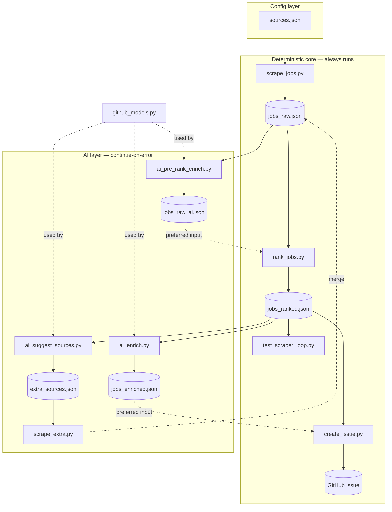

# Architecture

## Architectural style

**Linear, staged batch pipeline (ETL) with graceful degradation.** Each stage is a standalone
Python script that communicates only through JSON files in `/tmp/jobs/`, orchestrated by a single
GitHub Actions workflow. Evidence: there is no shared runtime, no imports between stage scripts
except the shared [github_models.py](../.github/scripts/github_models.py) helper; stages read one
file and write another (`jobs_raw.json` → `jobs_raw_ai.json` → `jobs_ranked.json` →
`jobs_enriched.json`). The deterministic core (scrape → rank → publish) is wrapped by *optional*
AI stages marked `continue-on-error: true` in the workflow, so the pipeline always produces a
digest even when every AI call fails. Parsers follow a **"never raise"** contract — on any
fetch/parse error they return an empty list and log to stdout, so one broken source never breaks
the run.

## Stage / data-file layer diagram

Communication direction is strictly downstream through files. The only "upstream" write is
`scrape_extra.py` merging back into `jobs_raw.json` (second-pass augmentation), after which
`rank_jobs.py` re-runs.

## Component relationships

| From | To | Relationship | Evidence |
|---|---|---|---|
| `scrape_jobs.py` | `sources.json` | reads + validates at load | `_load_source_config()` line 159 |
| `scrape_jobs.py` | search providers | HTTP via fallback chain | `_fetch_google_proxy_via_provider()` line 743 |
| `scrape_jobs.py` | `jobs_raw.json` | writes | `main()` line 2160 |
| `ai_pre_rank_enrich.py` | `jobs_raw.json` → `jobs_raw_ai.json` | reads/writes | module header |
| `rank_jobs.py` | `jobs_raw_ai.json` ?? `jobs_raw.json` | reads (AI file preferred) | `main()` line 637 |
| `rank_jobs.py` | `jobs_ranked.json` | writes | `main()` line 720 |
| `ai_suggest_sources.py` | `jobs_ranked.json` → `extra_sources.json` | reads/writes (conditional) | module header |
| `scrape_extra.py` | `extra_sources.json` + `jobs_raw.json` | reads, merges in-place | module header |
| `ai_enrich.py` | `jobs_ranked.json` → `jobs_enriched.json` | reads/writes (always writes) | module header |
| `create_issue.py` | `jobs_enriched.json` ?? `jobs_ranked.json` | reads (enriched preferred) | `load_data()` line 13 |
| `create_issue.py` | GitHub Issues | writes via `gh issue create` | `create_issue()` line 40 |
| all AI stages | `github_models.py` | import `complete_json()` | `from github_models import complete_json` |

## Key design decisions

| Decision | Rationale |
|---|---|
| JSON files in `/tmp/jobs/` as the only inter-stage contract | Stages stay independent and individually runnable/testable; no shared process state |
| AI stages are `continue-on-error` and optional | AI is additive, never load-bearing; the deterministic pipeline ships without it (though a hard external-resource outage fails loud per ADR-0002) |
| Parsers never raise (return `[]` + log) | One failing source must not abort the run; pipeline degrades gracefully |
| Data-bearing external calls fail loud (geolocation / AI / MCP) — retry then raise, no synthetic fallback ([ADR-0002](adrs/ADR-0002-no-synthetic-fallback-external-resources.md)) | A fabricated stand-in (country constant, neutral score, guessed enrichment) silently poisons the digest; a failed run is recoverable |
| Source registry externalized to `sources.json` | Add/remove scrape targets without touching Python; validated at load time |
| Pre-emptive token-bucket rate limiting per domain | Avoids 429s entirely rather than retrying after them; Google throttled hardest (~0.02 req/s) |
| Provider fallback chain (SearXNG → CSE → SerpAPI → Zenserp → direct) | Avoids direct-Google quota exhaustion; prefers free local SearXNG first |
| Deterministic weighted scoring (`0.35·loc + 0.35·lang + 0.30·relevance`) | Reproducible ranking independent of AI availability |
| Never trust job-title language | DACH boards show English titles over German bodies; language inferred from body/markers/domain |
| Validation loop (`test_scraper_loop.py`) re-runs until thresholds | Transient fetch/parser issues self-heal before publish |

See [patterns.md](patterns.md) for the conventions these decisions produce in code, and
[data-flows.md](data-flows.md) for the step-by-step flows.
