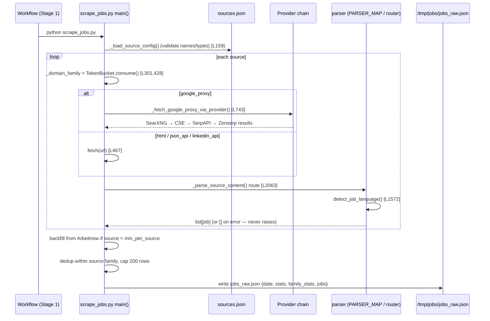
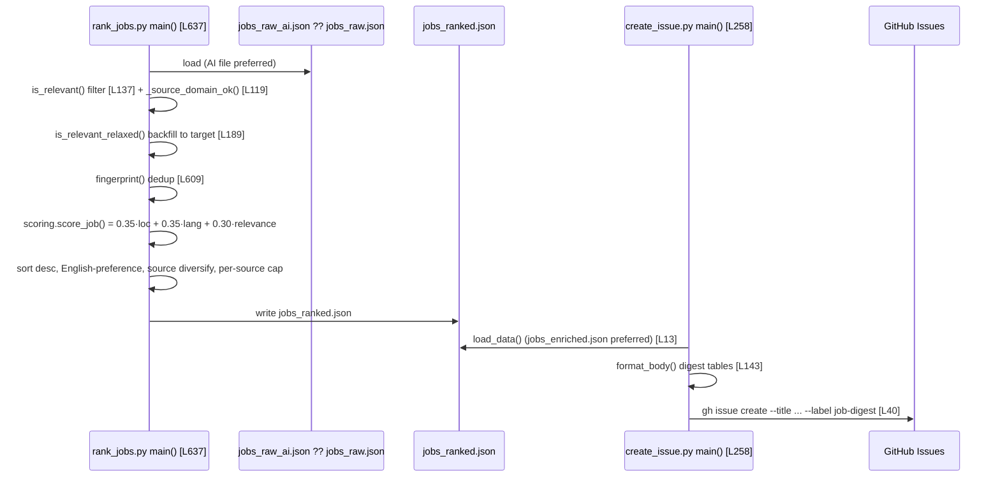
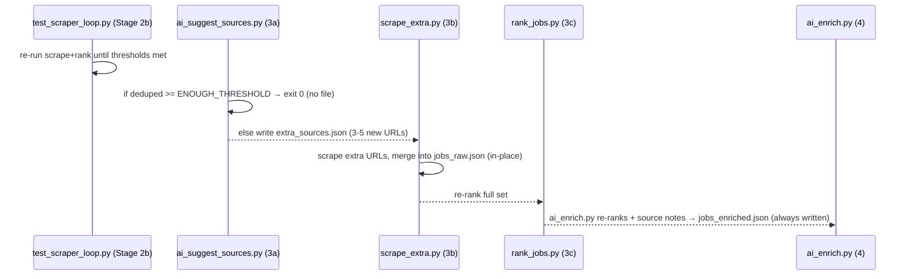

# Data flows

All stages communicate through JSON files in `/tmp/jobs/`. There is no HTTP server and no event
bus — "write path" below means *scrape → persist raw*, "read path" means *rank → publish digest*,
and "event consumption" is reinterpreted as the *second-pass / AI augmentation* path.

## Write path — scrape to raw JSON

## Read path — rank to published digest

## Second-pass / AI augmentation path

## CHANGE IMPACT MAP

### Adding a new scrape source (the most common change)

Sources are **data, not code** — most additions touch only JSON. You only touch Python when the
source needs a *new `type`*.

1. **Add an entry** to [.github/config/sources.json](../.github/config/sources.json) under `sources`.
   Required fields: `name` (unique), `type`, `region`. Then by type:
   - `html` / `json_api` → explicit `url`
   - `linkedin_api` → `location`, `start`, and `keywords` or `keyword_set`
   - `google_proxy` / `search_proxy` → `query` (+ optional `num`, default 20)
2. If `type` is `html` **and the site needs bespoke parsing**, add the source `name` → parser
   function in `PARSER_MAP` (line 2044) in [.github/scripts/scrape_jobs.py](../.github/scripts/scrape_jobs.py).
   Reuse `parse_stepstone` / `parse_karriere_at` / `parse_jobs_ch` if the markup is similar.
3. If you need a brand-new `type`, add it to `_KNOWN_SOURCE_TYPES` (line 76) **and** wire it into
   the router `_parse_source_content()` (line 2063). Never add parsing logic to the JSON.
4. (Optional) add a `fallbacks` entry mapping `name` → `[alternate urls]`.
5. **Add a test** in [.github/tests/test_sources_config.py](../.github/tests/test_sources_config.py)
   and, for a new parser, a fixture-backed test in
   [.github/tests/test_scrape_jobs.py](../.github/tests/test_scrape_jobs.py). Tests must mock HTTP.

### Adding a new parser type

1. Write `parse_<thing>(content, source_name) -> list[dict]` in `scrape_jobs.py`. Must return `[]`
   on any error (never raise), and set language via `detect_job_language()` (line 1572).
2. Register the `type` in `_KNOWN_SOURCE_TYPES` (line 76).
3. Add a branch in `_parse_source_content()` (line 2063) routing the new `type` to your parser.
4. If it's an `html` site-specific parser, also map its `name`(s) in `PARSER_MAP` (line 2044).
5. Add rate-limit tuning in `_RATE_LIMIT_CONFIG` (line 383) if the new domain needs a specific cadence.
6. Add a fixture + test (never hit live sites).

### Adding a field to a job row

Job rows are plain dicts with no schema class — a new field must be threaded through every stage
that reads/writes it:

1. **Produce it** in the relevant parser(s) in `scrape_jobs.py` (the dict built per job).
2. If AI should populate/correct it, extend the prompt + parse in
   [ai_pre_rank_enrich.py](../.github/scripts/ai_pre_rank_enrich.py).
3. **Consume it** in `rank_jobs.py` (filters, e.g. `is_relevant`) or `scoring.py` (`score_job`) if it
   affects filtering/scoring.
4. **Display it** in `create_issue.py` `format_body()` (line 143) if it belongs in the digest.
5. Update fixtures/assertions in the relevant tests.

### Changing the ranking formula or filters

- Scoring weights / components → `score_job()` and the three component functions
  (`vienna_distance_score`, `language_score`, `it_management_focus_score`) in
  [scoring.py](../.github/scripts/scoring.py). Distance is geolocated (Nominatim, no static table);
  a geocoding outage fails the run ([ADR-0002](adrs/ADR-0002-no-synthetic-fallback-external-resources.md)).
- Role rules → [position_filter.json](../.github/config/position_filter.json)
  (`excluded_areas`, `non_it_excluded`, `in_focus_roles`, …) via `position_filter.POSITION_FILTER`.
- URL/title guards → `BAD_URL_PATTERNS` (L68), `NON_JOB_TITLE_PATTERNS` (L56).
- Validation thresholds → env vars in the `Validate scraper loop` step of the workflow (`TEST_MIN_*`).

See [patterns.md](patterns.md) for conventions and [scenarios.md](scenarios.md) for the
business-rule locations.
