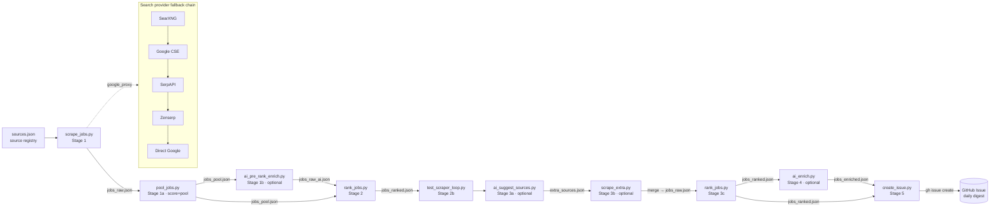

# Overview

## Purpose

DACH (Austria / Germany / Switzerland) executive tech-job pipeline. A scheduled GitHub Actions
workflow scrapes CTO / VP-Engineering / Head-of-Engineering listings from ~39 configured sources,
ranks them with a weighted scoring formula (deterministic given a cached, bounded geocoding step
that fails loudly on a geocoding outage rather than fabricating a fallback — [ADR-0002](adrs/ADR-0002-no-synthetic-fallback-external-resources.md)), and publishes a daily digest as a
GitHub issue. Optional AI stages (GitHub Models) enrich and extend the run but never block it —
the deterministic pipeline works standalone.

## Tech stack

| Component | Technology | Version |
|---|---|---|
| Language | Python | 3.12 |
| Orchestration | GitHub Actions (cron `7 4 * * *`) | — |
| HTTP / parsing | `requests`, `beautifulsoup4` | latest (pip-installed in CI) |
| Language detection (soft dep) | `langdetect`, `certifi` | latest |
| AI stages (optional) | OpenAI SDK → GitHub Models (`gpt-4o-mini`) | `models.inference.ai.azure.com` |
| Local search provider | SearXNG (Docker) | `searxng/searxng:latest` |
| Node runtime | Node.js (for MCP server stage, currently no-op) | 20 |
| Tests | pytest | — |
| Publish target | GitHub Issues via `gh` CLI | — |

No database, no message queue, no authentication layer. State lives entirely in `/tmp/jobs/*.json`
during a run; the only persisted output is a GitHub issue.

## High-level architecture

## Modules / building blocks

Grouped by pipeline stage (there are no bounded contexts in the DDD sense — this is a linear ETL):

| Stage | Script | Role |
|---|---|---|
| Config | [.github/config/sources.json](../.github/config/sources.json) | Source registry (single source of truth for scrape targets) |
| 1 Scrape | [.github/scripts/scrape_jobs.py](../.github/scripts/scrape_jobs.py) | Fetch + parse all sources → `jobs_raw.json` (every deduped row) |
| 1a Score+pool | [.github/scripts/pool_jobs.py](../.github/scripts/pool_jobs.py) | Score every row + build the per-family-minimum + merit pool → `jobs_pool.json` ([ADR-0003](adrs/ADR-0003-merit-based-ranking-pipeline.md)) |
| 1b Enrich | [.github/scripts/ai_pre_rank_enrich.py](../.github/scripts/ai_pre_rank_enrich.py) | AI metadata correction on the pool → `jobs_raw_ai.json` |
| 2 Rank | [.github/scripts/rank_jobs.py](../.github/scripts/rank_jobs.py) | Read the (AI-enriched) pool, filter + dedup + score → `jobs_ranked.json` |
| 2b Validate | [.github/scripts/test_scraper_loop.py](../.github/scripts/test_scraper_loop.py) | Re-run until thresholds met |
| 3a Suggest | [.github/scripts/ai_suggest_sources.py](../.github/scripts/ai_suggest_sources.py) | Propose extra sources → `extra_sources.json` |
| 3b Extra | [.github/scripts/scrape_extra.py](../.github/scripts/scrape_extra.py) | Scrape + merge extra sources |
| 4 Enrich | [.github/scripts/ai_enrich.py](../.github/scripts/ai_enrich.py) | AI re-rank + source quality notes → `jobs_enriched.json` |
| 5 Publish | [.github/scripts/create_issue.py](../.github/scripts/create_issue.py) | Format digest + open GitHub issue |
| Shared | [.github/scripts/github_models.py](../.github/scripts/github_models.py) | GitHub Models client helper (used by all AI stages) |
| Tooling | [discover_sources_mcp.py](../discover_sources_mcp.py), [.github/scripts/probe_searxng_queries.py](../.github/scripts/probe_searxng_queries.py) | Local source-discovery / query-tuning utilities |

## Entry points

| Entry point | Starts | Notes |
|---|---|---|
| [.github/workflows/dach-exec-job-alerts.yml](../.github/workflows/dach-exec-job-alerts.yml) | The full daily pipeline | cron `7 4 * * *` (≈06:07 CEST) + `workflow_dispatch` |
| `python .github/scripts/scrape_jobs.py` | Local scrape → `/tmp/jobs/jobs_raw.json` | `main()` at line 2160 |
| `python .github/scripts/rank_jobs.py` | Local rank → `/tmp/jobs/jobs_ranked.json` | `main()` at line 637 |
| `python .github/scripts/create_issue.py` | Publish digest (needs `gh`) | `main()` at line 258 |
| `pytest` | Test suite | config in [pytest.ini](../pytest.ini) |

See [architecture.md](architecture.md) for the architectural style and [data-flows.md](data-flows.md)
for the write/read paths and the change-impact map.
